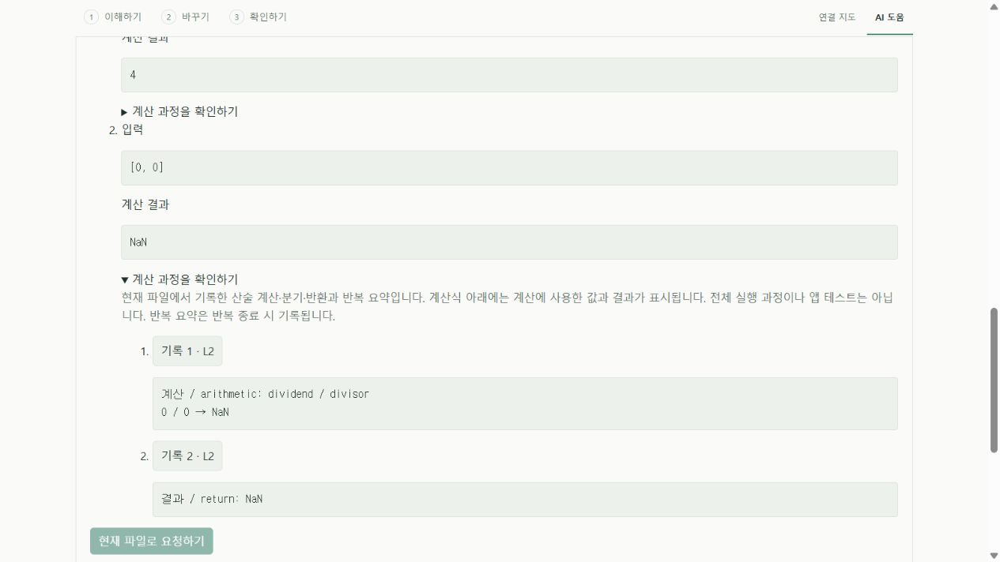
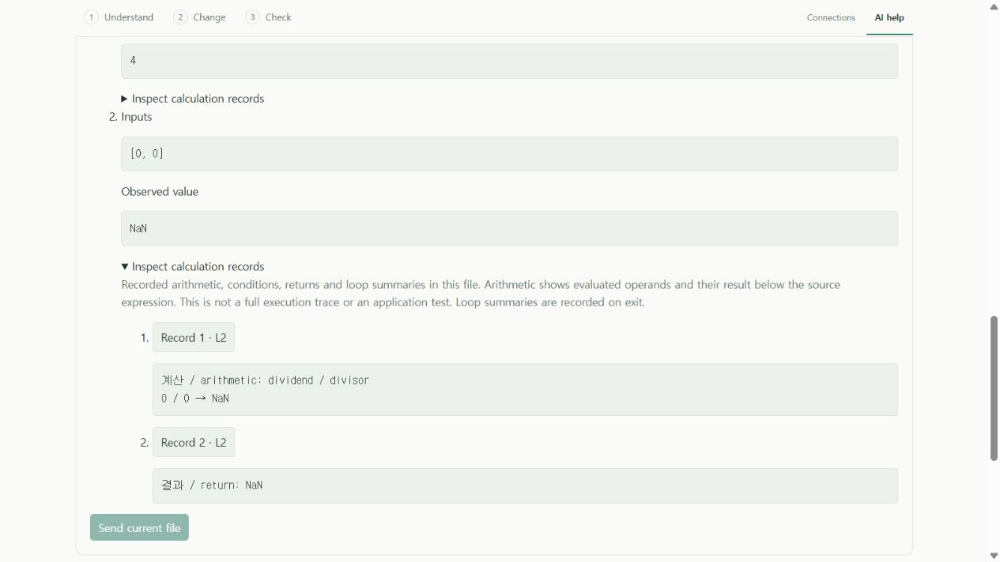

# 계산식에 실제 값 표시 · 0.7 개발판

최종값과 분기 기록을 첨부해도 실제 로컬 모델이 경계 결과의 원인을 잘못 설명했다. 사용자가 모델 없이 직접 대조할 수 있도록 JS/TS 예시 계산에 **원래 수식 → 계산에 사용한 값 → 결과**를 표시한다. 예를 들어 공개 예제의 `dividend / divisor`는 입력에 따라 `8 / 2 → 4` 또는 `0 / 0 → NaN`으로 보인다. 이는 기록 기능이며 모델 설명 정확도 개선을 입증한 결과가 아니다.

## 사용

**이해하기 → 이 기능을 로컬 AI로 설명 → 예시 입력으로 설명 확인하기 → AI 없이 예시 계산**에서 결과의 **계산 과정을 확인하기**를 펼친다. **기록 번호 · L줄**을 누르면 원래 연산 줄로 이동한다. 계산·기록·원문 이동에는 Ollama 연결이나 API가 필요하지 않다. 선택적으로 설명을 요청하면 같은 호스트 보관 기록을 로컬 모델에 첨부한다.

아래 이미지는 공개 나눗셈 예제로 확인한 실제 확장 UI·worker와 모의 편집기다. 비공개 프로젝트 화면이나 실제 모델 응답은 아니다. 원문 이동 요청 연결은 UI에서, 실제 파일/줄 이동은 native 통합 검사에서 확인했다.





## 정확히 기록하는 범위

- 기존 해석기가 수행한 이항 `+`, `-`, `*`, `/`, `%`, `**`와 해당 지원 복합 대입의 산술 부분을 기록한다. 이미 계산한 피연산자를 재사용하므로 `n++ / n++`의 값을 다시 실행해 기록하지 않는다. 줄 번호는 연산자 위치다. 문자열 덧셈·숫자 변환이 있는 연산도 실제 피연산자 표현을 표시한다.
- `NaN`, 양/음의 무한대, `-0`을 그대로 표시한다. 이런 숫자 결과 자체를 예외로 분류하지 않는다. 복합 대입의 산술 기록만으로 뒤따르는 대입까지 완료됐다고 단정하지 않는다.
- 단축 평가나 조건식으로 건너뛴 연산은 기록하지 않는다. 비교·비트 연산·단항 연산·함수 호출 내부를 모두 기록하는 기능은 아니다. 모든 비정상 숫자의 최초 원인을 찾거나 전체 명령을 추적한다고 주장하지 않는다.
- [기존 실행 기록](EXPLANATION_EXECUTION.md)의 현재 파일 한도·원문 연결·오래된 결과 차단을 유지한다. 기록당 800자, 예시당 12개/4,000자다. **앞선 비유한 산술 결과 최대 2개 → 끝 4개 → 앞 6개 → 나머지** 순으로 중복 없이 후보를 골라 한도를 적용한 뒤 원래 순서로 표시한다. 반환값만으로 가려지던 중간 연산을 남기기 위한 선택이며 완전한 추적은 아니다.
- 잘렸거나 너무 큰 기록은 첨부하지 않고 생략 안내를 표시한다. 해석기 전체의 200개/30,000자 기록 한도 뒤의 연산을 복구하지 않는다. 표시할 수 없는 중간값 때문에 계산 자체를 중단하지 않으며 최종값 전달 검사는 유지한다. 기록에는 추가 계산 비용이 있고 성능 개선 기능으로 세지 않는다.

## 실제 프로젝트 대조와 한계

사용자가 지정한 같은 비공개 함수·같은 일곱 입력을 변경하지 않고 실제 제품 worker에서 다시 계산했다. 반환 여섯 개는 native Node와 일치했고 예외 한 개는 제품에서 확인 불가였다. 이전 관찰값도 그대로였다. 비유한 산술 결과를 표시한 사례는 두 개이며, 반환 여섯 사례 모두 기록 한도에 따라 일부 과정이 생략됐다. 소스 해시와 깨끗한 평가 복사본 상태를 확인했다.

이는 새 일곱 사례나 전체 프로젝트 검증이 아니다. 반환값 대조와 기록 표시를 확인한 것이며 각 중간 연산을 독립적인 native 계측으로 전부 대조하지는 않았다. 새 모델 요청은 수행하지 않았으므로 앞선 [실제 7B 설명 실패](evidence/local-ai/execution-records-model.json)는 해결된 것으로 처리하지 않는다. 비공개 원문·식별자·구체 입력/반환값·원시 기록은 공개하지 않는다. 익명 집계만 공개해 제삼자가 해당 비공개 실험을 완전히 재현할 수는 없다.

## 검사와 재현

기능 커밋 `c64bc4a`에서 핵심 부분 88개/7파일, 확장 빌드, 실제 VS Code 개발 호스트 예시 부분 6개·원문 이동 부분 3개가 통과했다. 새 핵심 여섯 검사는 연산별 값, 부작용의 한 번 평가, 건너뛴 분기, 특수값/문자열, 중간 비유한 결과 보존, 큰 기록 생략을 다룬다. native HTTP의 모델 답변은 제어된 fixture다. [로그 해시·UI·실제 코드 집계](evidence/local-ai/arithmetic-records-verification.json)를 전체 CI 및 모델 의미 평가와 구분한다.

첫 전체 CI는 Windows·Ubuntu 모두 핵심 334 pass/1 fail이었다. 기존 값 전달 검사의 ‘첫 기록은 반환’ 가정을 수정하고 실제 반환 기록의 특수값 검사는 유지했다. native 검사에서도 같은 가정을 제거했다. 회귀 부분 12개 통과 뒤 테스트 전용 후속 `00eedd7`에서 전체 CI를 확인했다. 제품 런타임은 `c64bc4a`와 동일하다. 같은 비공개 과제의 새 설명 입력은 제품의 문맥 예산 검사를 통과했지만, 이는 모델 응답의 완료·정확성을 검증한 것이 아니다.

`00eedd7`의 [Windows·Ubuntu 최종 CI](https://github.com/him55710-sudo/pureobom/actions/runs/39337702532)는 각 핵심 **335개**, 개발/production 설치 각각 **67개**, 설치 파일 11개 해시·패키지 검사 7개를 통과했다. [실제 로그에서 추출한 근거](evidence/local-ai/arithmetic-records-ci.json)에 새 연산 기록·원문 이동·값 보존 검사를 포함했다. 비공개 예시 대조에 쓴 로컬 worker와 공개 화면에 쓴 UI JS/CSS의 해시도 두 운영체제 설치본과 일치했다. 같은 검사의 환경별 반복이며 모델 정확도 점수로 합산하지 않는다. 안정판/Pages는 변경하지 않았다.

```sh
pnpm exec vitest run tests/arithmetic-records.test.ts tests/assistant-observations.test.ts tests/trace-source.test.ts tests/iteration-preview.test.ts tests/explanation-coverage.test.ts tests/local-assistant.test.ts tests/ollama.test.ts
pnpm extension:build
node scripts/test-extension.mjs --explanation-observations
node scripts/test-extension.mjs --trace-source
node scripts/preview-function-format.mjs --arithmetic
```

English: inspect original arithmetic expressions beside the operands and result actually computed by the bounded JS/TS interpreter, without model inference. Operands are evaluated once. Source links identify the original operator line; omitted steps and stale evidence remain explicit. This is neither a full debugger nor proof of model accuracy, native application correctness or optimization. The unchanged private task still has six matching returns and one unavailable case; no new model-quality claim is made.
