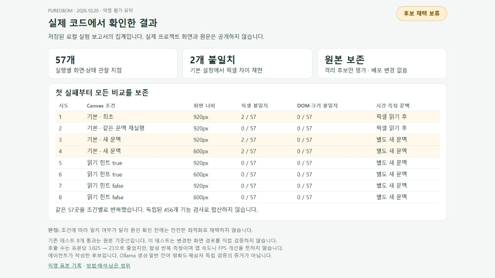

# 실제 웹 화면 최적화 평가 · Canvas evaluation

2026-10-20. 사용자가 지정한 비공개 프로젝트의 **실제 웹 진입점과 자산**으로 평가했다. 예제 문제를 새로 만들거나 프로젝트 이름만 바꾼 fixture가 아니다. 원본은 수정하지 않았고 후보는 격리된 메모리·로컬 파일에서만 실행했다. 결과는 [익명 측정 기록](evidence/local-ai/canvas-evaluation.json)에 보존한다. 비공개 코드, 식별자, 구체 입력·반환값, 화면, 원시 보고서는 공개하지 않는다.

## 무엇을 검증했나

같은 이미지가 유지되는 동안 반복 그리기를 생략하는 후보를 에이전트가 작성했다. 크기 변경 때 캐시를 무효화하고, 오버레이·진행 표시·접근성 상태 갱신은 유지했다. 실제 Pureobom 제안 파서가 세 편집 범위와 원문 인용을 받아들였으며 후보 JavaScript 문법 검사를 통과했다. **이번 후보는 Ollama가 생성한 응답이 아니다.** 새 모델 품질, native 편집기의 적용·undo 또는 자동 최적화 성공 근거로 세지 않는다.

별도 로컬 어댑터에서 실제 HTML·CSS·이미지·모듈을 제공하고 브라우저에서 전후를 실행했다. 두 쪽의 외부 글꼴 요청은 제거했다. 선택한 진행 지점, 같은 크기/다른 크기 resize, 효과 전환, 이미지 누락·교체의 **57개 관찰 지점**에서 Canvas 전체 픽셀 해시와 관련 DOM 상태를 비교했다. 이는 제어된 렌더 호출이며 실제 사용자의 스크롤 경로·모든 이벤트 순서를 검증한 것은 아니다.

기존 프로젝트 테스트 **8개 통과**는 원래 복사본의 기준선 검사다. 이 테스트들은 변경한 화면 그리기 경로를 직접 다루지 않으므로 후보의 동작 보존 증거로 사용하지 않는다. 어댑터·제안·원시 픽셀 해시는 비공개 평가 폴더에만 보존했다. 원본의 깨끗한 Git 상태와 대상 소스 해시를 다시 확인했다.

## 측정 자체도 검증 대상이다

첫 기본 설정 비교에서 57곳 중 2곳의 픽셀이 달랐다. DOM 상태는 모두 같았다. 같은 Canvas를 재사용한 두 번째 실행은 전부 일치했지만 첫 실패를 지우지 않았다. 새로운 Canvas에서도 차이가 생기는지 확인하고자 넓은/좁은 화면 및 세 가지 문맥 설정으로 추가 비교했다.

`getImageData()`는 단순한 관찰 비용만 추가한다고 가정할 수 없다. [Chromium 구현](https://chromium.googlesource.com/chromium/src/+/500947f508e484696c809b5ea84568bfd51b320a/third_party/blink/renderer/modules/canvas/canvas2d/base_rendering_context_2d.cc)은 읽기 힌트가 없는 가속 Canvas에서 반복 읽기가 CPU 전환을 유발할 수 있는 경로를 포함한다. [HTML 표준](https://html.spec.whatwg.org/multipage/canvas.html#concept-canvas-will-read-frequently)도 읽기 최적화와 GPU/CPU 저장 방식의 차이를 설명한다. 이번 브라우저의 실제 내부 백엔드 전환을 계측하지 않았으므로 이는 **측정 조건에 대한 가설을 뒷받침하는 자료**이며 원인 확정이 아니다.

추가 실험의 `willReadFrequently: true`/`false`는 양쪽 측정 어댑터에만 동일하게 적용했다. 프로젝트에 권장하는 수정이 아니며 최초 실패를 해소한 코드 변경도 아니다. `false`가 특정 GPU 실행을 보장한다거나 `true` 설정에서의 성공이 기본 환경의 성공을 의미한다고 주장하지 않는다.

| 시도 | 조건 | 너비 | 픽셀 불일치 | DOM·크기 불일치 |
| --- | --- | --- | --- | --- |
| 1 | 기본 설정·최초 | 920px | 2/57 | 0/57 |
| 2 | 기본 설정·같은 문맥 재실행 | 920px | 0/57 | 0/57 |
| 3 | 기본 설정·새 문맥 | 920px | 2/57 | 0/57 |
| 4 | 기본 설정·새 문맥 | 600px | 2/57 | 0/57 |
| 5 | 읽기 힌트 true·새 문맥 | 920px | 0/57 | 0/57 |
| 6 | 읽기 힌트 true·새 문맥 | 600px | 0/57 | 0/57 |
| 7 | 읽기 힌트 false·새 문맥 | 920px | 0/57 | 0/57 |
| 8 | 읽기 힌트 false·새 문맥 | 600px | 0/57 | 0/57 |

같은 57곳을 조건별로 재실행한 것이며 456개 독립 기능 검사로 합산하지 않는다. 조건별 일치 결과는 읽기 방식 가설과 일관되지만 기본 환경에서의 차이 원인을 확정하지 않는다. [집계 화면](evidence/local-ai/canvas-evaluation.html)은 저장된 결과를 표시하는 정적 보고서이며 검증 실행 UI나 범용 제품 기능이 아니다.

## 속도 수치의 한계

시간 표본 하나는 제어된 진행 값마다 반복하는 **3,025회 동기 렌더 호출**이다. 한 번 워밍업 후 전후 순서를 번갈아 7쌍을 측정했다. 이는 중복 호출을 의도적으로 많이 넣은 스트레스 시나리오다. 요청 수 감소를 실제 사용자 워크로드의 개선률로 바꾸지 않는다.

첫 두 실험은 픽셀을 읽은 같은 Canvas에서 시간을 쟀다. 추가 여섯 실험은 정확성 비교 후 새 문맥을 만들어, 그 문맥에서는 픽셀을 읽지 않고 시간을 측정했다. 두 종류를 같은 조건의 표본으로 합치지 않는다. `performance.now()` 구간은 동기 호출 제출과 DOM 작업을 포함하며 GPU 완료·합성·화면 프레임률·메모리·초기 로딩·사용자 지연은 측정하지 않았다. 시스템 부하·열·순서·브라우저 내부 처리도 영향을 준다.

각 표본의 이미지 제출은 3,025회에서 23회로 줄었다. 모든 시도의 표본과 중앙값은 JSON에 남겼다. 특히 읽기 힌트 true·600px의 기준선 중앙값은 약 7,373ms로 다른 조건보다 매우 컸다. 이를 숨기거나 앱이 몇 배 빨라졌다는 근거로 사용하지 않는다. 이번 평가에서 실제 FPS나 체감 성능 개선은 확인되지 않았다.

## 판단과 재현 범위

**후보는 채택하지 않았다.** 기본 설정의 픽셀 차이를 설명하고 실제 이벤트·브라우저 환경을 추가 확인하기 전에는 안전한 최적화나 앱 속도 개선을 주장할 수 없다. 테스트 통과, 제안 형식 통과, 호출 수 감소를 각각 별도의 근거로 취급한다. 사용자의 원본과 배포는 바뀌지 않는다.

다른 프로젝트에서 같은 절차를 적용할 때는 다음 순서로 검증한다.

1. 프로젝트 버전·원본 해시·환경을 고정하고 실제 실행 진입점을 확인한다.
2. 원본을 보존한 격리 후보를 만들고 기존 검사 중 변경한 동작을 실제로 다루는 항목을 확인한다.
3. 정확성 기준과 관찰 지점을 먼저 정하고, 전후에 동일한 자산·설정·입력으로 실행한다.
4. 관찰 API가 실행 조건에 영향을 줄 수 있으면 새 문맥으로 시간 측정을 분리한다.
5. 실패한 첫 시도까지 보존하고 원인 미확정·미측정 항목을 결과와 함께 기록한다.

이 문서는 프로젝트별 평가 방법과 이번 실행 기록이다. 범용 Canvas 자동 검증 기능이나 제삼자의 독립 검증으로 제공하지 않는다. 공개 재현에는 사용자의 비공개 소스가 필요하므로 원시 실험을 공개 저장소만으로 재실행할 수 없다는 제한이 있다. 기존 [사용자 명령 전후 측정](BENCHMARKS.md)은 별도 제품 기능이다.

English: this is an agent-reviewed experiment against a real private web application, using an agent-authored candidate accepted by the product proposal parser. It is not a local-model optimization success or a reusable browser-validation product feature. The original project remains unchanged. Initial failures, controlled-context diagnostics, synthetic submission timing, baseline project checks, and remaining gaps are recorded separately. The candidate is not adopted.
