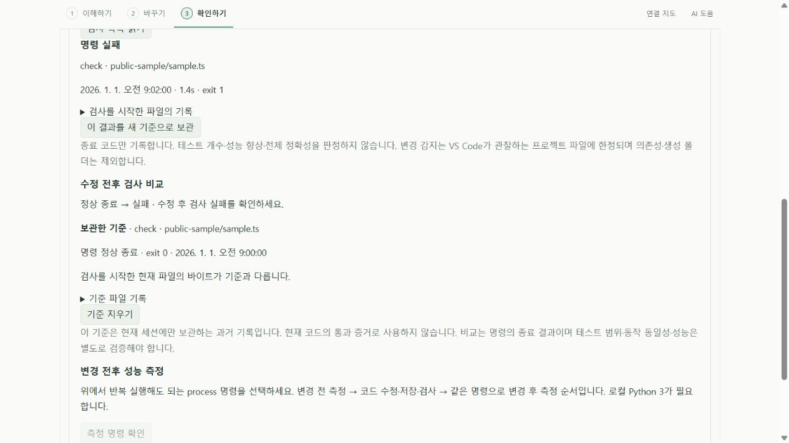
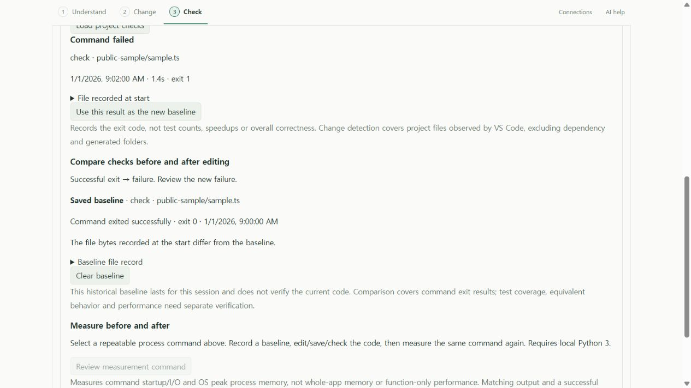

# 수정 전후 프로젝트 검사 비교 · 0.7 개발 기능

기존 프로젝트 검사 결과를 기준으로 보관하고, 코드를 수정한 뒤 같은 검사의 종료 결과를 비교한다. [실제 프로젝트 검사](PROJECT_CHECKS.md)와 함께 사용하며 AI 연결이나 유료 API는 필요하지 않다. 프로젝트 명령 자체의 외부 서비스 사용·비용은 그 프로젝트에 따른다. 안정 버전 0.6.0에는 아직 포함되지 않았다.

## 사용하는 순서

1. **확인하기 → 프로젝트 검사와 성능 측정**에서 검사 목록을 읽고 실제 명령을 검토한다.
2. 저장한 프로젝트로 실행한다. 완료된 결과의 **수정 전 기준으로 보관**을 누른다. 정상 종료뿐 아니라 기존 실패도 기준으로 삼을 수 있다.
3. 원하는 코드를 수정하고 저장한다. 기준은 당시의 기록으로 남으며 현재 소스의 통과 증거로 사용되지 않는다.
4. 같은 명령을 다시 실행한다. 현재 결과와 보관한 기준의 상태·종료 코드·시각·파일 SHA-256을 볼 수 있다.
5. **이 결과를 새 기준으로 보관**으로 기준을 교체하거나 **기준 지우기**로 제거한다. 기준은 확장 세션에만 보관하며 재시작하면 사라진다.

| 표시                 | 확인한 사실                                                        | 따로 확인할 내용                               |
| -------------------- | ------------------------------------------------------------------ | ---------------------------------------------- |
| 정상 종료 → 실패     | 같은 조건의 명령이 이번에는 0 이외 코드로 종료                     | 어떤 검사와 원인이 달라졌는지 터미널 로그 확인 |
| 실패 → 정상 종료     | 같은 조건의 명령이 이제 0으로 종료                                 | 검사 범위 밖 동작·실제 요구 사항               |
| 두 번 모두 정상 종료 | 두 실행 모두 0으로 종료                                            | 동작 동일성·성능 향상은 증명하지 않음          |
| 두 번 모두 실패      | 두 실행 모두 0 이외 코드로 종료                                    | 실패의 원인이나 개수가 같은지는 알 수 없음     |
| 비교 불가 또는 대기  | 조건 변경, 오래된 결과, 실행 중, 취소, 시간 초과, 종료 코드 미확인 | 동일 조건에서 다시 검사                        |

선택한 파일의 바이트가 같은지도 별도로 표시한다. **현재 파일 바이트 일치가 전체 프로젝트 파일 일치를 뜻하지 않는다.** 소요 시간을 성능 비교로 계산하지 않으며 테스트 개수·실패 원인을 자동 추측하지 않는다. 기존 실패가 있는 프로젝트도 정확한 로그를 함께 비교해야 한다.

## 기준을 믿을 수 있는 범위

웹뷰는 결과 전체를 제출하지 않고 실행 ID만 전달한다. 호스트에 남아 있는 최신 완료 결과여야 하며 현재 문서, 저장 상태, 디스크 해시, task 존재·실행 정보·관련 설정, package manifest를 다시 확인한다. 검사/성능 측정 중, 다른 실행 ID, 오래된 결과, 미저장 파일은 기준 보관을 거절한다. 화면에 돌려준 기준 객체를 수정해도 내부 기록은 바뀌지 않는다.

비교는 파일 URI·프로젝트·task 실행 정의·관련 환경 설정·manifest 전체 해시가 같을 때만 허용한다. `package.json`에서 검사와 직접 무관한 필드를 바꿔도 보수적으로 비교 불가가 된다. 새 조건을 검토하고 새 기준을 만들어야 한다. 환경 변수 값은 웹뷰로 보내지 않는다.

이것은 전체 프로젝트 스냅샷이나 재현 가능한 실행 환경이 아니다. 파일 감시의 제외 폴더·작업 공간 바깥 의존성·실행 파일 변경·네트워크/DB 상태 등은 [기존 검사 범위](PROJECT_CHECKS.md#결과가-유효한-범위)를 따른다. 명령 정의가 같아도 외부 상태는 달라질 수 있다. 실행 이후 변경이 감지된 현재 결과는 비교에 쓰지 않으며, 이전에 보관한 기준 자체는 당시의 기록으로 유지한다.

## 검증한 내용

- 핵심 11개: 네 가지 종료 결과 조합, 별도 실행 대기, 취소·시간 초과·실행 중·종료 코드 미확인, 불일치 종료 코드, 설정 식별자 차이, 오래된 결과, 파일 해시 차이, 반환 객체 분리.
- 실제 VS Code 공개 fixture: 기존 npm 검사 정상 종료를 고정하고 값 수정 후 실패를 비교했다. native undo 뒤 정상 종료·원문 바이트 일치를 확인했다. 잘못된 실행 ID·오래된 결과 보관 거절, 과거 기록의 현재 코드 증거 사용 금지, manifest 변경 후 비교 거절, 기준 교체·삭제도 확인했다. 의도적으로 삽입한 fixture 오류이며 upstream 버그 발견이 아니다.
- 실제 비공개 사용자 프로젝트: 고정 검증 복사본의 원래 검사 → 기준 보관 → 선택한 함수의 줄바꿈 정리 → 검사 → native undo → 검사를 수행했다. 세 실행 모두 exit 0·stale false였다. 수정 후 파일 바이트 차이, undo 후 원래 바이트 일치와 동일한 기준 ID 유지를 확인했다. 정확한 diff를 에이전트가 검토했으며 독립 제삼자 검증은 아니다. 원본 작업 폴더는 수정하지 않았고 검증 복사본도 깨끗하게 복구했다.
- 한/영 화면: 실제 빌드 UI/worker와 공개 모의 결과에서 정상 종료→실패, 기준 삭제, 새 기준 보관과 대기 상태를 확인했다. 이 화면은 실제 비공개 프로젝트 결과가 아니다.

[익명 결과와 재현 자료](evidence/local-ai/check-comparison-verification.json), [운영체제별 CI](evidence/local-ai/check-comparison-ci.json). 원문·프로젝트 식별자·원시 결과는 공개하지 않는다. 기존 모델 설명의 의미 실패, 전체 앱 정확성·과학적 타당성·성능 개선 미검증 상태는 유지한다.

첫 전체 CI는 Windows·Ubuntu 모두 기준 보관 단계에서 실패했다. 진단을 추가한 실행은 `package.json`의 늦은 변경 알림 때문에 정상 종료 결과가 오래된 결과로 표시됐음을 확인했다. 공개 테스트가 manifest를 수정/복구한 뒤 변경 알림까지 기다리도록 고쳤다. 제품의 변경 감지와 기준 보관 차단을 완화하지 않았다. [최초 실패·진단·수정 기록](evidence/local-ai/check-comparison-ci-first-failure.json).

알림 동기화 후에는 전체 순서에서 열린 manifest의 재로드로 분석이 갱신 중임을 확인했다. 테스트가 문서 재로드와 분석 완료까지 기다리도록 보완한 뒤 로컬 실제 VS Code 전체 72개가 통과했다. [후속 실패와 준비 순서 수정](evidence/local-ai/check-comparison-ci-reload-failure.json). API 보호 조건을 우회하거나 실패를 자동 재시도한 것이 아니다.

`d9e11b2`의 [Windows·Ubuntu CI](evidence/local-ai/check-comparison-ci.json)는 각 핵심 **369개/37파일**, 실제 VS Code 개발·production 설치 **각 72개**, 설치 파일 11개·패키지 검사 7개를 통과했다. 기능 런타임은 `c602693`이며 후속 커밋은 테스트 동기화만 바꿨다. 로컬 확장·worker·UI JS/CSS 네 파일은 양쪽 설치본과 일치하고, 로컬 개발 VSIX의 실행 파일 11개는 Windows 설치본과 일치한다. 개발용 VSIX의 전체 ZIP 해시는 [익명 결과](evidence/local-ai/check-comparison-verification.json)에 기록한다. 실제 설치 검증과 로컬 ZIP/실행 파일 대조를 구분한다.

```text
pnpm exec vitest run tests/check-comparison.test.ts
pnpm extension:build
node scripts/test-extension.mjs --package-scripts
node scripts/preview-function-format.mjs --check-comparison
```

native 검사는 PATH의 Node/npm이 필요하다. 공개 UI fixture는 명령을 실행하지 않는다.




