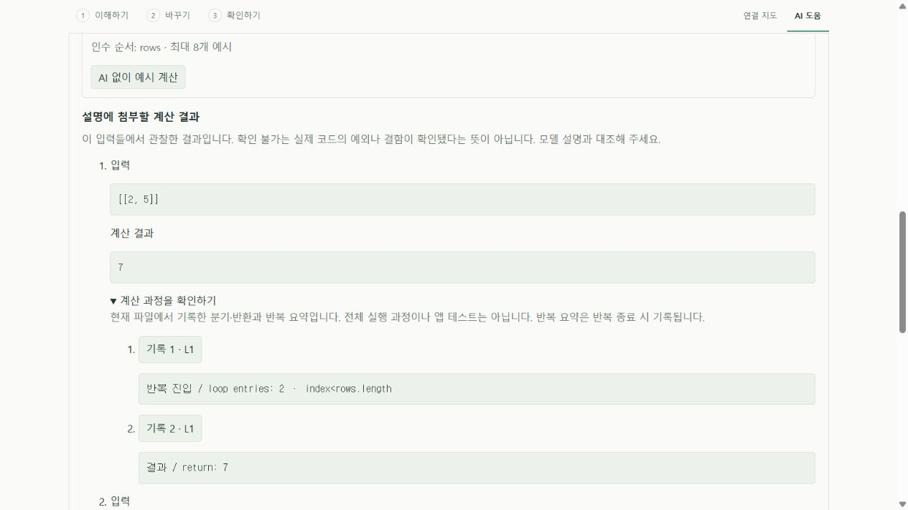
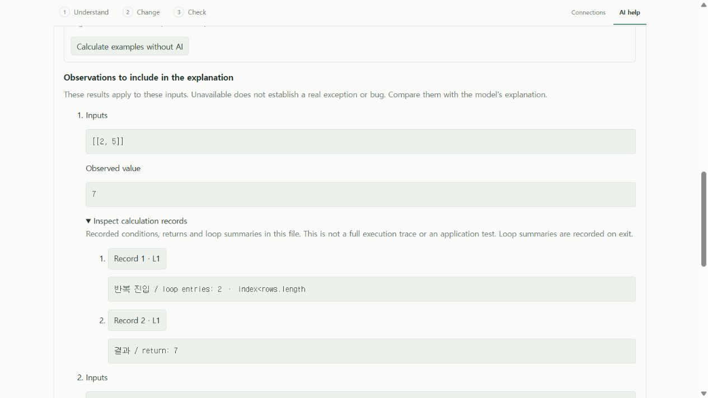

# 계산 과정과 모델 설명 대조 · 0.7 개발판

계산한 최종값을 첨부해도 로컬 모델이 실제와 다른 분기를 설명했던 평가에 대응한 보완이다. 선택한 JS/TS 함수의 각 예시에 **현재 파일에서 기록한 조건 결과·반환·반복 요약**을 표시하고 설명 요청에 함께 보낸다. 계산 기록은 모델이 생성하지 않는다. 모델 설명의 의미 정확성을 자동으로 보증하지는 않는다.

## 사용법

1. **이해하기 → 이 기능을 로컬 AI로 설명 → 예시 입력으로 설명 확인하기**에서 예시를 입력하고 **AI 없이 예시 계산**을 누른다.
2. 각 예시의 **계산 과정을 확인하기**를 펼쳐 그 입력에서 기록된 조건과 결과를 읽는다. **기록 번호 · L줄** 버튼은 해당 원문 줄로 이동한다. Ollama 연결 없이도 계산·기록·원문 이동을 사용할 수 있다.
3. 설명을 요청하면 호스트가 보관한 같은 계산 기록을 로컬 모델에 첨부한다. 모델 문장과 계산값·기록·원문을 대조한다. 다른 입력이나 파일로 바꾸면 다시 계산한다.

화면 아래는 공개 예제와 모의 편집기로 확인한 실제 UI다. 모델 생성·native 화면 클릭의 증거가 아니며 실제 native 원문 이동은 별도 통합 검사로 확인한다.





## 기록의 의미와 한도

- 기존 한도 있는 AST 해석기에서 조건 결과, 명시적 반환, 표현식 본문의 화살표 함수 반환, 반복 진입 횟수 요약을 기록한다. 일반 대입·모든 표현식·암묵적 반환 등 전체 명령을 기록하는 디버거는 아니다. 반복 요약은 반복 종료 때 기록되므로 세부 명령의 시작 순서로 읽지 않는다.
- 현재 파일의 기록만 첨부한다. 가져온 다른 파일의 코드·경로·기록을 자동 첨부하지 않는다. 현재 파일에서 관찰한 반환값에는 다른 파일의 계산 결과가 반영될 수 있으며, 이는 기존 최종값 관찰과 같은 범위다.
- 예시당 최대 12개 기록, 기록당 800자, 합계 4,000자다. 12개를 넘으면 앞 8개·뒤 4개를 먼저 고른 뒤 합계 한도를 적용한다. 원래 기록 번호를 유지해 간격을 드러내며, 제외하거나 표시하지 못한 기록이 있으면 생략 안내를 표시한다. 기존 해석기의 200개/30,000자 기록 한도 뒤의 과정도 복구했다고 주장하지 않는다.
- 값·문장을 부분적으로 잘라 정확한 관찰처럼 모델에 보내지 않는다. 이미 잘렸거나 너무 큰 기록은 제외한다. 중간 반환값을 표시할 수 없어도 계산 자체를 중단하지 않으며, 최종 반환값의 기존 전달 가능 여부 검사는 유지한다.
- 실패한 계산은 실패 전의 부분 기록만 있을 수 있다. 기록의 부재는 특정 분기를 실행하지 않았다는 증거가 아니다. **확인 불가**는 실제 앱 예외·결함을 확정하지 않는다.

예시 최대 8개, 입력·원문·문맥·출력·시간 제한은 기존 [예시 계산](EXPLANATION_OBSERVATIONS.md)과 [로컬 AI](LOCAL_AI.md)의 범위를 따른다. 기록을 추가해 모델 문맥 한도를 넘으면 요청을 거절한다. 추가 근거가 응답 시간이나 정확도를 항상 개선한다고 주장하지 않는다. 기본 UI 언어는 한국어·영어이며 기록 텍스트는 원문 표현과 한/영 공통 표기를 유지한다.

## 구현과 검증 경계

`simulate.ts`의 기록을 `assistantObservations.ts`에서 현재 파일·크기 기준으로 선별한다. `localAssistant.ts`는 기록의 수·길이·순서·원문 줄 범위를 검사하고 프롬프트에 기록과 생략의 의미를 명시한다. 모델이 없는 기록을 완성하거나 기록 속 문자열을 지시로 취급하지 않도록 요청한다. 이는 모델이 실제로 그 지시를 지켰다는 검증과 다르다.

`LocalAssistantController`는 중첩 기록을 깊은 복사로 보관한다. 웹뷰는 계산 식별자·예시/기록 번호만 보내며 표시한 줄·문장을 임의 교체해 원문 이동이나 모델 근거를 바꿀 수 없다. 최신 문서·버전·원문·계산 식별자를 다시 확인한다. 다른 계산으로 바뀌거나 파일을 편집하면 이전 기록 이동을 거절한다.

핵심 검사는 입력별 실제 분기·반환, 다른 파일 기록 제외, 생략과 원래 번호, 큰 중간값·반환된 함수가 계산을 방해하지 않는지, 잘못된 기록 거절을 다룬다. 실제 VS Code 부분 검사는 worker 기록, 깊은 복사, 원문 이동, 잘못된 번호와 오래된 기록 거절, 실제 HTTP 요청의 전달을 검증한다. HTTP 모델 답변은 제어된 fixture이며 실제 모델 의미 품질과 구분한다. 현재 검증 결과·실패·실제 모델 평가 상태는 [작업 기록](AGENT_WORKLOG.md)에 남긴다.

동일 비공개 과제의 실제 7B CPU 응답은 약 512초에 완료됐다. 이번에는 여섯 반환값을 맞게 기술했으나 입력 검사/호출 조건을 혼동하고 경계 결과의 원인·입력 구성을 잘못 설명해 과제는 여전히 실패했다. [실제 모델 평가](evidence/local-ai/execution-records-model.json)와 [부분 검사·UI·실패 기록](evidence/local-ai/execution-records-verification.json)을 분리한다. 단일 반복 요청이며 일반 모델 정확도 개선을 입증하지 않는다.

기능 커밋 `0cf6b34`의 [Windows·Ubuntu CI](https://github.com/him55710-sudo/pureobom/actions/runs/39335563440)는 각 핵심 **329개**, 개발/production 설치 각각 **66개**, 설치 파일 11개 해시·패키지 검사 7개를 통과했다. 실제 로그에서 새 기록·변조 방어·원문 이동 검사를 대조한 [운영체제별 근거](evidence/local-ai/execution-records-ci.json)다. 통합 검사의 모델 답변은 제어된 fixture이며 위 실제 모델 의미 평가와 합산하지 않는다.

```sh
pnpm exec vitest run tests/assistant-observations.test.ts tests/trace-source.test.ts tests/iteration-preview.test.ts tests/explanation-coverage.test.ts tests/local-assistant.test.ts tests/ollama.test.ts
pnpm extension:build
node scripts/test-extension.mjs --explanation-observations
pnpm extension:package
node scripts/test-extension.mjs --installed --explanation-observations
node scripts/preview-function-format.mjs --execution
```

English: expand each calculated example to inspect current-file condition/return records and loop-exit summaries, then follow a record to its original source line. The same host-retained records are included in optional local-model explanations. These are bounded interpreter observations, not a full debugger trace, native application tests or automatically verified model claims. Other-file records and oversized/undisplayable records are excluded with an omission notice. Original record indexes are preserved. Stale handles and client mutations cannot replace host evidence.
