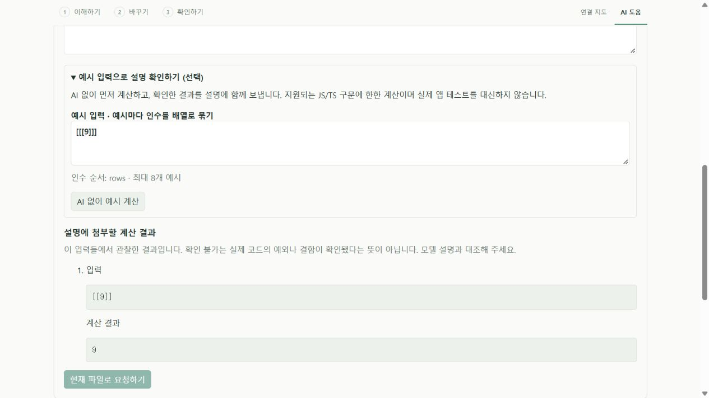
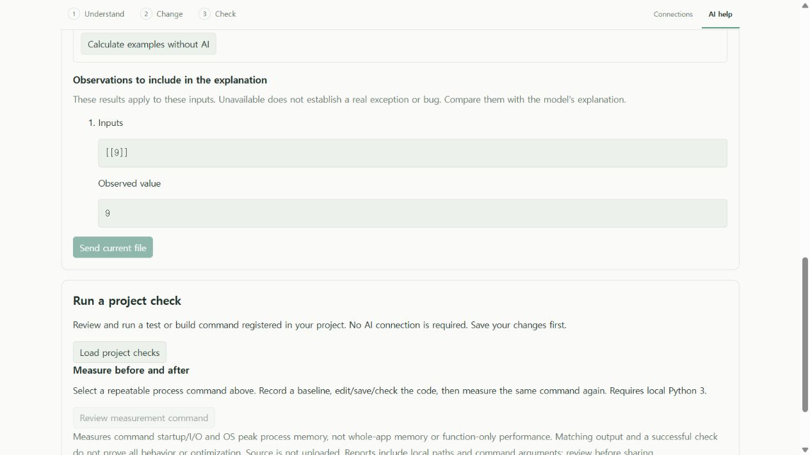

# 예시 계산으로 설명 대조하기 · 0.7 개발판

실제 사용자 코드에 대한 이전 모델 답변은 원문을 인용하면서도 입력별 결과를 잘못 설명했다. 이제 선택한 JS/TS 함수에 직접 예시 입력을 넣고 **AI 없이 계산한 결과를 먼저 확인**할 수 있다. 원한다면 그 결과를 로컬 모델의 설명 요청에 함께 보낸다. 모델의 설명을 자동으로 정답 판정하는 기능은 아니다.

## 사용과 범위

1. 로컬 VS Code의 **이해하기 → 이 기능을 로컬 AI로 설명**에서 함수를 선택한다.
2. **예시 입력으로 설명 확인하기**를 열고 예시마다 인수 배열을 입력한다. `sum(rows)`에 `[1,2]`와 빈 배열을 각각 전달하려면 `[[[1,2]], [[]]]`를 입력한다. 화면에 인수 순서가 표시된다.
3. **AI 없이 예시 계산**을 누른다. 이 과정은 Ollama 연결이나 모델·API 키가 필요 없다. 반환값 또는 확인 불가 이유를 먼저 읽는다.
4. 로컬 모델로 설명을 요청하면 현재 화면의 계산 결과가 함께 전달된다. 입력·대상 함수·파일을 바꾸면 다시 계산한다. 모델 설명과 결과·원문을 대조한다.

JS/JSX/TS/TSX의 [지원되는 계산 구문](BOUNDED_PREVIEW.md)에 한한다. 최대 8개 예시, 예시당 20개 인수, 입력 전체 UTF-8 8,000바이트다. 입력은 JSON이며 `undefined`·NaN 등을 직접 쓰는 확장 문법은 제공하지 않는다. 계산에서 나온 NaN·무한대·-0·undefined는 문자열로 보존한다. 표시 한도를 넘는 결과를 조용히 잘라 보내지 않는다.

계산은 기존 worker의 한도 있는 AST 해석기를 사용한다. 사용자 코드를 Node/eval로 실행하지 않으며 파일·네트워크 부작용을 실행하지 않는다. 계산마다 기존 4,000단계 등 한도를 유지한다. 선택한 원문 범위와 실제 해석 대상이 일치해야 하므로, 같은 이름의 중첩 함수 대신 다른 함수를 계산하지 않는다. 읽어 둔 소스 스냅샷이 대상이며 외부 변경을 모두 감시하거나 전체 앱을 실행하는 기능은 아니다.

**확인 불가**는 실제 앱의 예외나 결함을 확정하지 않는다. 미지원 구문·범위·계산 한도일 수도 있다. 반환값도 해당 입력에 대한 제한된 해석 결과다. 실제 프로젝트의 기존 테스트, 다른 입력과 환경, 성능 측정은 별도로 확인해야 한다. 다른 프로그래밍 언어의 예시 계산이나 모든 자연어 지원을 주장하지 않는다. UI는 한국어·영어다.

## 모델에 전달하는 근거

확장 호스트가 현재 파일·버전·선택한 함수·계산 식별자와 결과 사본을 보관한다. 화면은 식별자만 보내며 임의 결과를 첨부할 수 없다. 파일 변경, 다른 함수, 이전 계산, 수정 작업의 첨부는 모델 요청 전에 거절한다. 모델 프롬프트에는 실제 계산 결과와 확인 불가를 구별하고, 예시를 전체 입력으로 일반화하지 않도록 지시한다. 이 지시를 모델이 정확히 따랐는지는 별도 검토 대상이다.

현재 파일 전체·요청·계산 예시가 클라우드를 끈 loopback Ollama로 전달된다. 다른 소스 파일을 모델에 자동 첨부하지 않는다. 기존 합산 프롬프트·출력·180초 생성 한도를 유지하며, 예시를 추가해 한도를 넘으면 거절한다. 유료 API 대체 경로는 없다. 모델 설치·저장 공간·PC 연산 비용은 든다. 공개 안정판/Pages **0.6.0**은 이 개발 기능을 포함하지 않는다.

## 실제 코드와 검증 결과

변경하지 않은 비공개 사용자 프로젝트의 원래 설명 대상에서, 앞서 선정했던 경계 입력 7개를 새 worker 동작으로 계산했다. 실제 Node 실행에서 반환한 **6개는 값이 일치**했다. 실제 실행에서 예외가 난 **1개는 제품에서 확인 불가**였다. 마지막 사례는 제품이 실제 예외를 증명했다는 뜻이 아니다. 원본 해시와 깨끗한 평가 checkout을 확인했고 소스·구체 입력·출력·식별자는 공개하지 않는다. 선정 사례이며 프로젝트 원래 테스트 7개로 세지 않는다.

같은 원문·질문의 7B CPU 모델 요청은 예시 첨부 전 기준으로 180초 생성 시간 초과였다. 예시 첨부를 준비한 3B 요청은 연결 확인 중 시간 초과로 `/api/chat`에 도달하지 못했다. 처음 상태 설명의 ‘3B가 180초 동안 생성했다’는 해석은 로그 확인 후 정정했다. **예시 첨부에 따른 모델 정확도 개선은 아직 평가하지 못했다.** 두 시도 모두 전체 답변이 없고 원문은 그대로다. 실패를 제외하거나 단순한 다른 질문으로 성공률을 대체하지 않는다.

핵심 부분 검사 68개(새 검사 8개 포함), 웹·확장 빌드, 실제 VS Code 개발 호스트와 새 production 설치본의 부분 검사 각 3개가 통과했다. 설치 파일 11개 해시를 확인했다. 공개 고정 코드와 제어된 HTTP 모델 응답으로 전달·변조 거절·오래된 근거 차단을 검사한 결과이며 실제 모델 품질과 구분한다. [실행별 원자료](evidence/local-ai/explanation-observations.json).

최종 기능 소스 `7a6e368`의 [Windows·Ubuntu CI](https://github.com/him55710-sudo/pureobom/actions/runs/39323929101)는 각 **핵심 312개·개발 확장 64개·production 설치본 64개**를 통과했다. 실제 로그에서 새 예시 검사 3개의 포함 여부, 설치 파일 11개 해시와 패키지 검사 7개를 대조했다. [운영체제별 기록](evidence/local-ai/explanation-observations-ci.json). 로컬 부분 검사나 모델 실패를 이 결과로 대체하지 않는다.

브라우저에서는 실제 빌드 UI/worker와 공개 예제, 모의 편집기·모델 응답을 사용했다. 모델 연결 전 계산, 입력 변경 시 결과 해제, 한국어/영어 안내, 첨부 표시와 다른 함수 선택 시 이전 결과 해제를 조작해 확인했다. native VS Code 화면 클릭 검증으로 바꾸어 부르지 않는다.





## 재현

```sh
pnpm exec vitest run tests/assistant-observations.test.ts tests/local-assistant.test.ts tests/ollama.test.ts tests/iteration-preview.test.ts tests/trace-source.test.ts
pnpm build
pnpm extension:build
node scripts/test-extension.mjs --explanation-observations
pnpm extension:package
node scripts/test-extension.mjs --installed --explanation-observations
node scripts/preview-function-format.mjs --focus
```

부분 검사는 `explanation-observations-only` 범위와 별도 보고서 파일을 사용한다. 같은 검사가 기본 전체 개발/설치 CI에도 포함된다. `tests/assistant-observations.test.ts`, `extension/test/explanationObservations.ts`에서 공개 검증 코드를 읽을 수 있다.
