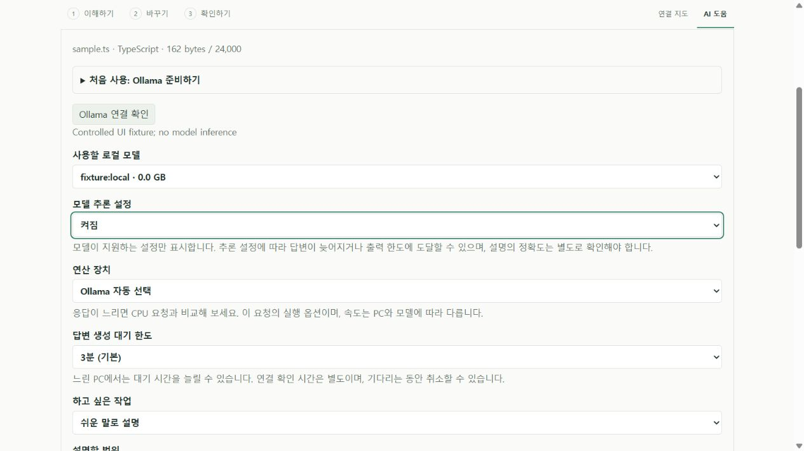
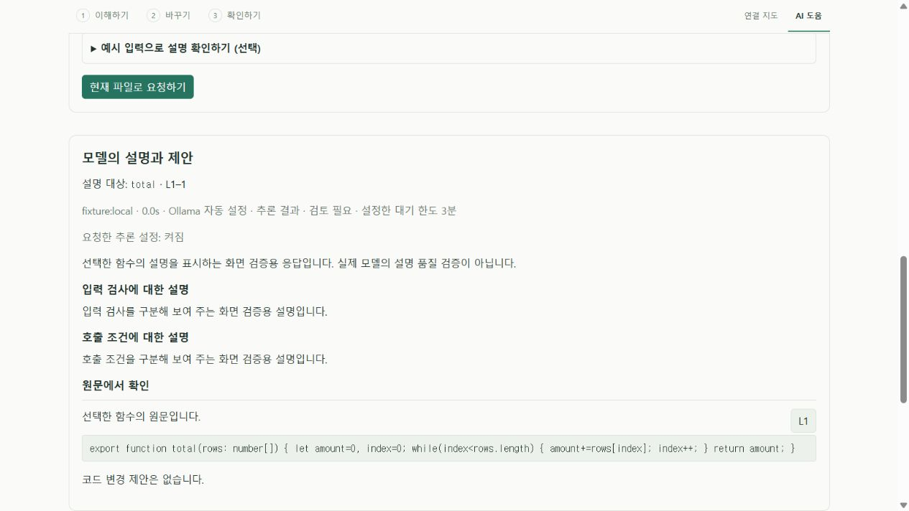
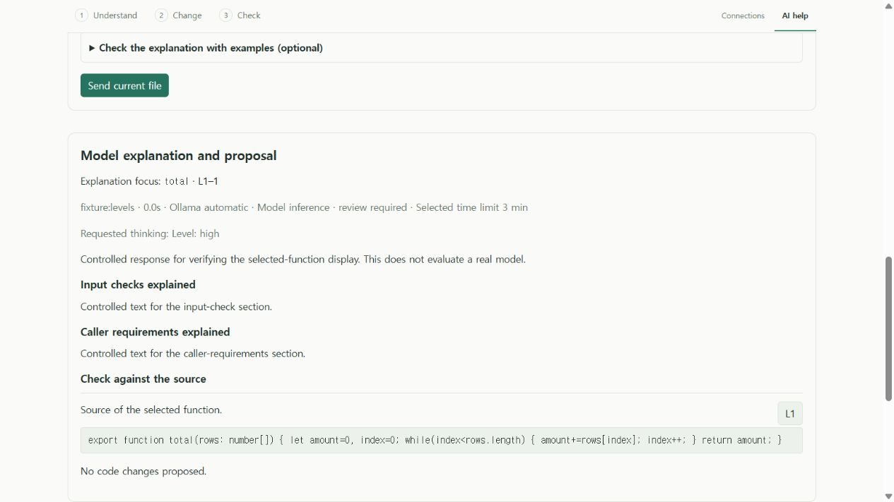

# 로컬 모델의 추론 설정 · Local model thinking

0.7 개발판의 선택형 로컬 AI 기능이다. 공개 0.6.0 릴리스·브라우저 데모의 기능으로 안내하지 않는다. 설정 전달 검증과 실제 모델 설명의 정확성을 구분한다.

## 사용 방법과 변경 이유

**Ollama 연결 확인 → 로컬 모델 → 모델 추론 설정** 순서로 선택한다. 기본은 **모델 기본값**이다. 서버가 켜짐·꺼짐 또는 이름이 있는 수준을 제공하면 그 값만 선택지로 표시한다. 지원 정보가 없으면 기본값만 사용할 수 있다. 모델 변경·재연결은 선택과 이전 제안을 초기화하며 지원 정보를 다시 읽는다. 한글·영문 결과에 요청한 설정을 남긴다.

이전 개발판은 `thinking.values`에 `false`가 있으면 추론을 자동으로 껐다. 이번에는 사용자가 해당 설정을 비교할 수 있게 했으며 모델 기본값을 임의로 끄지 않는다. 이는 설명 품질 개선이 입증됐다는 뜻이 아니다. 생성 시간·출력 한도에 도달하면 완성 제안이 없을 수 있다.

## 구현 경계

- `src/core/localAIThinking.ts`: boolean과 모델이 제공하는 문자열 수준을 구분한다. `null`은 모델 기본값이다. 문자열 `"true"`를 boolean으로 바꾸지 않는다. 잘못된 형식·제어 문자·과도한 길이와 중복 항목을 제한한다.
- `extension/src/ollama.ts`: `modelOptions()`는 로컬 전용 상태·설치 모델·모델 정보를 확인하며 소스 코드를 보내지 않는다. 생성 직전 같은 검사를 다시 하고, 명시적 선택이 최신 지원 목록에 없으면 `/api/chat`을 호출하지 않는다. 기본값은 `think`를 생략하고 나머지는 정확한 타입과 값으로 전달한다.
- 호스트와 UI는 해당 요청의 선택을 보관한다. 결과의 **요청한 추론 설정**은 요청 메타데이터이며 모델 내부가 실제로 어떻게 동작했는지 증명하는 계측이 아니다. 내부 추론 텍스트는 제품 결과·화면·공개 자료에 포함하지 않는다.
- CPU/자동 장치, 3·5·10분 한도, 4096 출력 토큰, 문맥 예산, 응답 형식·원문 인용 검증은 유지한다. 코드 적용·클라우드 대체·유료 API 호출을 추가하지 않는다.

Ollama의 [추론 제어 문서](https://docs.ollama.com/capabilities/thinking)를 2026-10-20 확인했다. 모델별 `values`와 `default`를 사용하며 지원되는 수준 이름을 추측하지 않는다. 로컬 Ollama 0.40.5에서 실제 Qwen3.5 4B는 `[false, true]`, 기본값 `true`를 반환했다.

## 재현과 증거

```text
pnpm exec vitest run tests/ollama.test.ts tests/local-ai-progress.test.ts tests/local-assistant.test.ts
pnpm extension:build
node scripts/test-extension.mjs --explanation-observations
node scripts/preview-function-format.mjs --thinking
```

마지막 명령은 임시 루프백 URL을 출력한다. 실제 빌드한 UI와 worker, 공개 합계 함수, 모의 편집기·모델 응답으로 화면을 확인한다. 첫 모델은 boolean, 두 번째는 이름 있는 수준, 세 번째는 지원 정보 없음이다. 실제 모델 품질 검사가 아니다.

부분 핵심 36개와 native 설명 부분 7개가 통과했다. HTTP 검사는 기본값 유지, boolean/문자열 타입, 없는 지원 정보, 새로 바뀐 지원 목록, 내부 추론 텍스트 제외를 검사한다. native 검사는 실제 VS Code 호스트→HTTP→반환 결과와 소스 보존을 다룬다. 화면에서는 한국어 켜짐·꺼짐, 영어 수준·기본값, 모델 변경 시 초기화와 요청 payload를 확인했다. [설정·실제 요청 동일성·로그 해시](evidence/local-ai/thinking-settings-verification.json).

화면 검증 중 안내문이 선택 상자에 붙고 굵게 보이는 것을 확인해 간격·줄 높이·글자 굵기를 수정했다. 기능 소스는 `88cd9a5`, 화면 간격 후속은 `e832712`이며 모델 요청 내용은 같다. 한국어/영어 결과 사진은 기능 빌드, 한국어 설정 폼 사진은 간격 수정 후 최종 빌드다. 새 설정의 접근성 이름도 확인했다.

최종 `e832712`의 [교차 OS 기록](evidence/local-ai/thinking-settings-ci.json)은 각 핵심 **350개**, 실제 VS Code 개발·production 설치 **각 69개**, 설치 파일 11개 해시·패키지 검사 7개를 확인한다. Ubuntu는 첫 실행에서 통과했다. Windows 첫 실행은 기존 Python 사례 하나가 테스트의 5초 한도를 넘어 **349 pass/1 fail**이었고, 코드·검사·한도 변경 없이 실패 작업만 재실행해 통과했다. [최초 실패](evidence/local-ai/thinking-settings-ci-first-failure.json)를 보존하며 시간 초과 원인을 확정하거나 해결했다고 주장하지 않는다. 로컬 확장·worker·UI JS/CSS 네 파일은 양쪽 설치본과 일치했다.







## 실제 코드 평가

이전 [산술 기록 후속](evidence/local-ai/arithmetic-model-followup.json)의 Qwen3.5 4B와 동일한 모델 digest·비공개 소스·함수·질문·일곱 입력·계산 기록·스키마·생성 예산을 유지해 켜기 요청을 한 번 추가했다. 실제 `/api/chat` 본문 전체가 `think` 값만 다름을 대조했다. [익명 결과·단계별 시간](evidence/local-ai/thinking-settings-model.json).

| 요청 설정 | 관찰 결과 | 설명 정확도 판정 |
| --- | --- | --- |
| 꺼짐, 이전 기록 | 427.619초에 완료·구조 검사 통과 | 반환값·입력 조건 설명 오류로 실패 |
| 켜짐, 이번 요청 | 600.016초에 생성 시간 초과 | 완성 응답을 받지 못해 미평가 |

켜기 요청의 연결·모델 확인은 성공했다. 생성 한도에 도달해 요청이 취소됐고 서버의 취소·유휴 상태를 확인했다. 구조 검증에 도달하지 않았으며 보지 못한 답변의 정확성을 실패나 성공으로 분류하지 않는다. 기본값을 따르거나 추론을 켜는 것만으로 이 실제 과제의 사용성과 정확도 문제가 해결됐다고 주장하지 않는다.

두 실행의 시점·캐시가 다르고, 이번 요청 일부와 UI 빌드·근거 재계산이 겹쳤다. 관찰된 지연을 일반적인 속도 차이·인과 효과로 추정하지 않는다. 본문이 같아도 모델의 토큰화와 출력 길이는 설정에 따라 다를 수 있다.

원문·실제 입력/반환값·원시 응답·내부 추론 텍스트는 공개하지 않는다. 원본 및 별도 검증 복사본을 보존했고 전용 모델 서버·runner의 경로/부모 관계를 확인해 종료했다. 다른 프로젝트 서버나 사용자 설정을 변경하지 않았다.

검증은 고정 커밋의 별도 복사본에서 했다. 마지막 원본 대조에서 대상 함수 파일은 줄끝 형식을 정규화하면 같은 본문이었지만, 현재 원본 작업 폴더의 커밋·수정 상태는 검증 복사본과 달랐다. 최초 바이트 해시 비교의 불일치를 기록하고 원본을 수정하지 않았다. 이 기록을 현재 작업 폴더 전체·최신 앱의 검증으로 확대하지 않는다.
