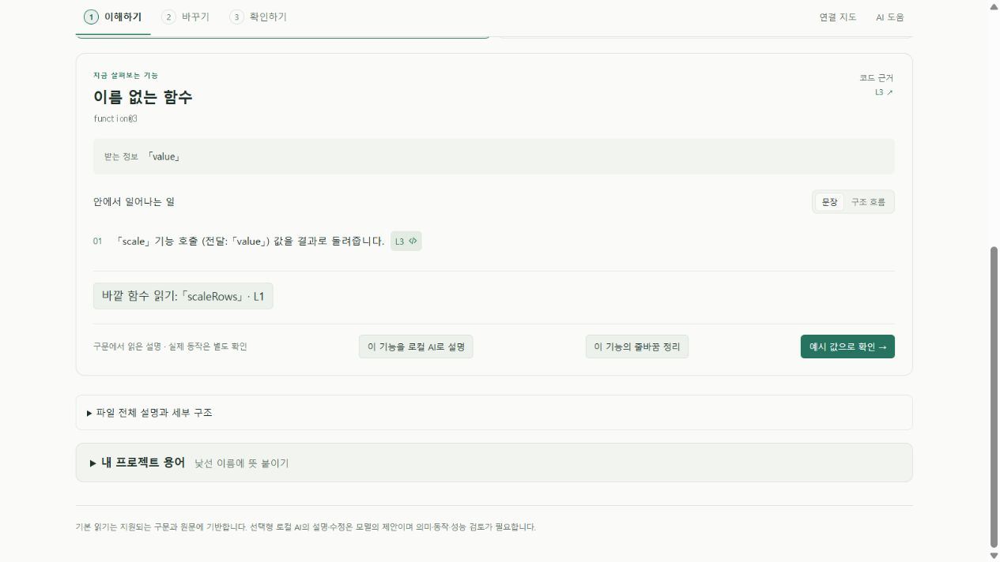
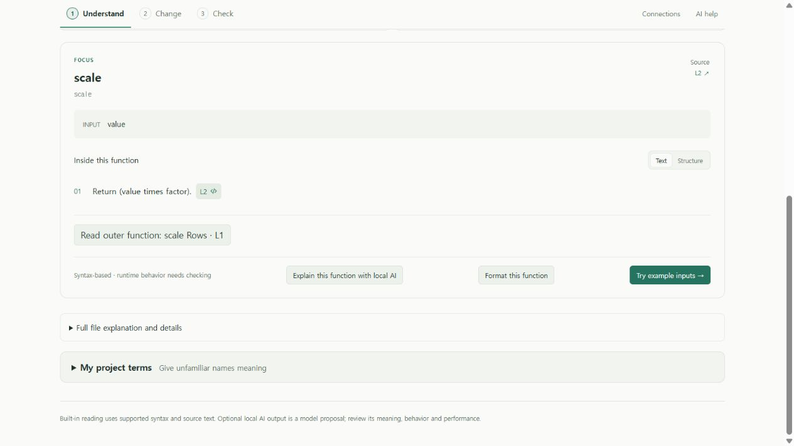

# 안쪽 함수 본문 읽기 · Nested function reading

0.7 개발 확장의 **이해하기 / Understand** 화면에서 함수 안에 정의된 함수의 입력·본문을 열고, 가장 가까운 바깥 함수로 돌아갈 수 있다. 이름 없는 콜백도 **이름 없는 함수 / Anonymous function**과 원문 줄 번호로 표시한다. 모델·API 호출이나 소스 수정은 없다.

이전 문법 설명은 콜백 본문을 “아래에서 보라”고 안내했지만 선택한 함수 화면에서 바로 이어 읽을 수 없었다. 이제 실제 함수 항목으로 이동하며, 안내문도 “해당 함수의 별도 설명”으로 바뀌었다. 선택 후 제목에 키보드 초점이 이동하고 기존 원문 줄 이동을 사용할 수 있다.

## 관계를 정하는 기준

`src/core/functionNesting.ts`는 분석기가 반환한 함수의 고유 ID와 시작·끝 위치를 사용한다. 선택한 범위를 포함하는 가장 작은 함수를 부모로, 직접 포함한 함수만 자식으로 연결한다. 한 줄의 여러 콜백이 같은 생성 이름을 가져도 ID로 구분한다. 같거나 인접한 범위를 부모·자식으로 취급하지 않는다.

이것은 **원문에 포함된 관계**이며 호출 관계나 실행 순서가 아니다. 가져온 함수의 구현, 동적 호출, 누락된 분석기 항목은 이 링크로 해석할 수 없다. 현재 변경은 JS/TS의 이름 없는 함수 표시를 개선했고, 탐색 자체는 기존 함수 위치 정보에 따른다. 모든 언어의 중첩 함수를 검증했다는 뜻이 아니다.

## 재현과 증거

```text
pnpm exec vitest run tests/function-nesting.test.ts tests/jsx.test.ts
pnpm extension:build
node scripts/preview-function-format.mjs --nested
```

마지막 명령은 실제 UI/worker와 공개 예제를 사용하는 모의 편집기 서버다. `scaleRows` 안의 이름 있는 함수·콜백을 열고 바깥 함수로 돌아간다. 실제 VS Code 클릭 검사와 구분한다.

- 부분 핵심 **18개/2파일**, 그중 새 관계 검사 **4개** 통과. 3단계 중첩, 같은 줄의 콜백, Unicode/CRLF 위치, 기본 매개변수의 콜백, 이름 있는 함수식, 인접·동일 범위, 입력 순서 보존을 다룬다.
- 한국어·영어 UI에서 직접 자식 두 개, 부모 복귀, 키보드 선택과 제목 초점, 관련 없는 함수에 링크 없음, 두 본문의 원문 요청을 확인했다. 모델·편집 요청은 없었다.
- 고정 비공개 프로젝트 복사본에서 실제 worker가 찾은 콜백 한 개의 전체 범위를 원문과 대조했다. 부모 복귀·반환 본문·익명 레이블과 원문 보존을 확인했다. 현재 원본 작업 폴더 전체의 검증으로 확대하지 않는다.

[익명 집계·UI 요청·빌드 해시](evidence/local-ai/nested-functions-verification.json). 검증 도구의 첫 집계는 잘못 지정한 UI 파일명 때문에 실패했고 실제 빌드 산출물 경로로 고쳐 다시 실행했다. 제품 실행 실패로 집계하지 않는다.

런타임 `c6248bc`의 [Windows·Ubuntu 전체 CI](evidence/local-ai/nested-functions-ci.json)는 각각 핵심 **354개/35파일**, 실제 VS Code 개발·production 설치 **각 69개**, 설치 파일 11개 해시·패키지 검사 7개를 통과했다. 로컬 확장·worker·UI JS/CSS 네 파일은 양쪽 설치본과 일치한다. 같은 검사의 환경별 반복이며 모델 정확도 점수가 아니다. 새 탐색의 화면 조작은 위 공개 브라우저 fixture에서 확인했으며 native 클릭 검사로 확대하지 않는다.





이 탐색 개선과 별개로 [실제 로컬 AI 설명 분할 실험](SPLIT_EXPLANATION_EXPERIMENT.md)은 실패했다. 문법 화면의 사용성 개선을 모델 의미 정확도의 개선으로 세지 않는다.
