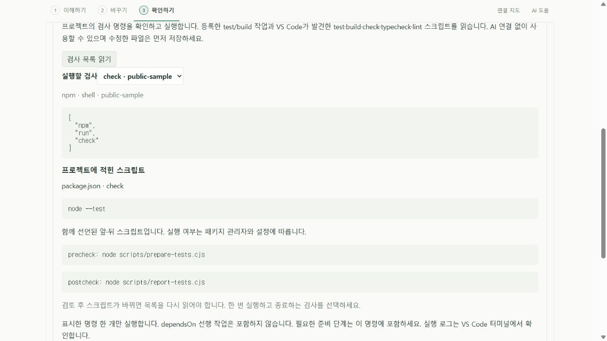
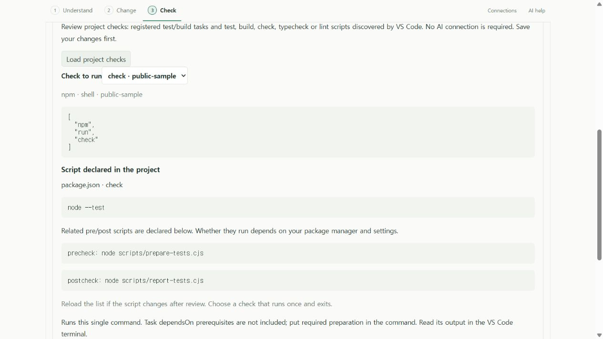

# 실제 프로젝트 검사 · 0.7 개발 기능

풀어봄의 **확인하기 / Check** 탭 또는 **AI 도움 / AI help** 탭에서 기존 프로젝트 검사 명령을 선택해 실행할 수 있다. Ollama 없이 사용할 수 있으며, 모델이 제안한 확인 문장을 명령으로 바꾸거나 실행하지 않는다. 이 기능은 아직 공개 안정 버전 0.6.0에 포함되지 않았다.

## 사용 흐름

1. 신뢰한 로컬 프로젝트 폴더에서 파일을 연다. Remote SSH·컨테이너·가상 작업 공간은 이 첫 구현의 지원 범위가 아니다.
2. 필요한 언어 도구와 프로젝트 의존성을 준비한다. 풀어봄은 이를 자동 설치하지 않는다.
3. **검사 목록 읽기**를 누른다. 같은 작업 공간 폴더의 `test` 또는 `build` 그룹 process/shell 작업을 읽는다. VS Code의 npm task provider가 발견한 `test`, `build`, `check`, `typecheck`, `lint` 스크립트도 그룹 지정 없이 표시한다. 이 다섯 이름의 package 스크립트는 별도 `tasks.json` 등록이 필요 없다. 백그라운드로 표시된 작업, 실행 정보 없는 작업, CustomExecution, 다른 폴더 작업은 제외한다.
4. 이름·명령·인수·작업 폴더를 읽고 실행 확인을 선택한다. package 작업은 실제 `package.json`의 스크립트와 선언된 `pre…`/`post…`도 표시한다. 앞·뒤 스크립트 실행 여부는 패키지 관리자와 설정에 따른다. 화면의 process 인수는 셸 명령 문자열이 아닌 JSON 배열로 표시되며 환경 변수 값은 전달하지 않는다.
5. 수정한 파일을 저장한 뒤 **저장된 프로젝트로 실행**을 누른다. 같은 폴더의 열린 미저장 파일 또는 미저장 새 문서가 있으면 중단한다. 자동 저장·자동 되돌리기는 하지 않는다.
6. VS Code 터미널에서 실제 출력을 읽는다. 풀어봄은 정상 종료/실패/종료 코드 미확인/취소/시간 초과와 시작 시각·소요 시간·시작 파일 SHA-256을 기록한다. 명령의 종료 코드 0은 테스트 개수나 전체 정확성의 보증이 아니다.

선택한 **명령 하나**를 독립적인 VS Code task로 실행한다. 원래 task의 `dependsOn` 선행 작업·`runOn` 자동 실행·감시 옵션을 복사하지 않는다. 빌드 후 테스트처럼 순서가 필요한 프로젝트는 그 순서를 프로젝트의 검사 스크립트 안에 넣어야 한다. 검사 목록과 실행 사이에 명령·인수·환경 등 설정이 바뀌면 다시 선택해야 한다. 복잡한 입력 변수나 제3자 task provider의 해석은 별도 검증 전까지 지원을 보장하지 않는다.

## 기존 package 스크립트 연결

VS Code에서 npm 스크립트 자동 검색이 켜져 있어야 한다. 실제 실행 파일은 VS Code가 선택한 패키지 관리자이며 npm 외에 pnpm도 사용할 수 있다. 풀어봄이 패키지 관리자를 설치하거나 바꾸지는 않는다. 목록에 없으면 VS Code의 **Npm: Auto Detect**, **Npm: Package Manager**, 제외 설정과 로컬 실행 파일·프로젝트 의존성을 확인한다.

package task는 위 다섯 이름만 표시한다. `dev`, `watch`, `install`, `publish`, `test:watch` 같은 이름을 검사로 추측하지 않는다. 다른 이름의 검사가 필요하면 아래처럼 명시적 process/shell 작업으로 등록한다. 이름이 `test`여도 실제 내용이 감시 모드일 수 있으므로 한 번 실행하고 종료하는 명령인지 검토해야 한다.

목록 읽기는 VS Code task provider와 manifest 읽기만 수행하며 스크립트를 실행하지 않는다. 실행 직전 task·관련 npm 설정과 manifest 전체 바이트 해시를 다시 대조한다. 본문, 앞·뒤 스크립트 또는 다른 manifest 필드가 바뀌면 목록을 다시 읽고 확인해야 한다. manifest는 작업 공간 안의 유효한 JSON 파일(선두 BOM 허용), 128 KiB 이하만 읽고 바깥을 가리키는 경로·심볼릭 링크/junction을 제외한다. 읽을 수 없는 package 작업은 표시하지 않는다.

선택한 패키지 관리자 명령은 `pre…`/`post…`나 스크립트 안의 다른 명령을 실행할 수 있다. 이것은 복사하지 않는 VS Code `dependsOn`과 별개다. 풀어봄은 manifest 문자열을 새 셸 명령으로 조합하지 않고 VS Code가 제공한 실행을 재사용한다. 변경 감지 범위와 실제 프로젝트 명령의 권한·비용은 아래 한계를 따른다.

구현 기준: [VS Code 작업 자동 검색](https://code.visualstudio.com/docs/debugtest/tasks#_task-autodetection), 검증한 버전의 [npm task provider 소스](https://github.com/microsoft/vscode/blob/1.96.4/extensions/npm/src/tasks.ts). 기존 provider는 `test`·`build` 계열을 그룹에 넣지만 `check`는 그룹이 없어 이전 필터에서 빠질 수 있었다.

### 검증과 실제 프로젝트

핵심 4개는 정확한 이름, 중첩 manifest·앞뒤 스크립트, 내용 변경, 잘못된 형식·크기, 경로 이탈과 junction을 검사한다. 실제 VS Code 흐름 2개는 목록 읽기 비실행·명령 검토·manifest 변경 차단과 **기존 assertion 통과 → 의도한 값 수정 후 실패 → native undo 후 통과**를 확인한다. 이것은 공개 fixture의 고정 오류 검출이며 upstream 버그 발견이 아니다.

고정 비공개 프로젝트에서도 별도 task 설정 없이 원래 그룹 없는 검사 스크립트를 발견하고 실행했다. 종료 코드 0·오래되지 않은 결과·소스/manifest 보존·깨끗한 checkout을 확인했다. 해당 명령의 테스트 수를 추정하거나 현재 원본 프로젝트 전체·화면·과학적 타당성을 검증했다고 확대하지 않는다. [익명 실제 결과·설정 실패·한/영 UI·로그 해시](evidence/local-ai/package-scripts-verification.json).

첫 로컬 native 검사는 테스트 PATH에 npm이 없어 종료 코드 1로 실패했다. 격리된 검증 폴더에 npm 10.9.2를 준비하고 그 테스트 프로세스의 PATH만 설정한 뒤 동일 제품/검사로 통과했다. 준비 중 생긴 test 전용 lockfile 항목은 원복했으며 제품 의존성은 추가하지 않았다. 자동 설치 기능이나 모든 실행 환경 지원으로 세지 않는다.

```text
pnpm exec vitest run tests/package-scripts.test.ts
pnpm extension:build
node scripts/test-extension.mjs --package-scripts
node scripts/preview-function-format.mjs --package-checks
```

native 재현에는 PATH에서 찾을 수 있는 npm·Node가 필요하다. UI 재현은 공개 모의 task 목록과 실제 UI/worker를 사용하며 명령을 실행하지 않는다. 한국어/영어 스크립트·앞뒤 명령 표시, 확인 전 실행 비활성화·확인 후 활성화·목록 갱신 후 확인 초기화를 점검했다.

런타임 `387a70f`의 [Windows·Ubuntu CI](evidence/local-ai/package-scripts-ci.json)는 각 핵심 **358개/36파일**, 실제 VS Code 개발·production 설치 **각 71개**, 설치 파일 11개·패키지 검사 7개를 통과했다. 새 package 스크립트 흐름 두 개도 양쪽 개발/설치 로그에서 확인했다. 로컬 확장·worker·UI JS/CSS 네 파일은 양쪽 설치본과 일치한다.

로컬 개발용 VSIX도 만들었고 Windows CI 설치본의 실행 파일 11개와 대조했다. [VSIX 해시](evidence/local-ai/package-scripts-verification.json)를 기록하며, 로컬 ZIP 대조와 CI의 실제 설치 검증을 구분한다. 안정 릴리스·Pages 배포나 일반 프로젝트 품질 인증이 아니다.





## 설정 예시

`.vscode/tasks.json`에 프로젝트에 맞는 명령을 직접 등록한다. 아래 `python`은 테스트 의존성이 설치된 프로젝트 인터프리터 경로로 바꿀 수 있다.

```json
{
  "version": "2.0.0",
  "tasks": [
    {
      "label": "Python tests",
      "type": "process",
      "command": "python",
      "args": ["-m", "pytest", "-q"],
      "options": { "cwd": "${workspaceFolder}" },
      "group": "test",
      "problemMatcher": []
    },
    {
      "label": "JavaScript tests",
      "type": "shell",
      "command": "pnpm",
      "args": ["test"],
      "group": "test",
      "problemMatcher": []
    }
  ]
}
```

프로젝트 검사 명령은 일반 개발 명령과 같은 권한으로 실행된다. 프로젝트 자체가 네트워크나 유료 서비스를 사용하도록 작성됐다면 그 동작과 비용은 그대로 남는다. **풀어봄의 로컬 AI가 유료 API를 호출하지 않는다는 설명과 프로젝트 명령의 동작은 구별해야 한다.**

## 결과가 유효한 범위

[modern-normalize의 실제 사례](evidence/local-ai/web-source-project.md)에서는 수정 전부터 7개 검사가 실패했다. 의도한 CSS 오류를 넣자 2개가 추가로 실패했고 undo 후 원래 7개로 돌아왔다. 세 단계 모두 task 종료 코드는 1이다. 기존 실패가 있는 프로젝트에서는 터미널의 구체적인 실패와 원본 결과를 비교해야 한다. 원본이 실패한다는 이유로 실패를 숨기거나 종료 코드 0으로 바꾸지 않는다.

- 다른 파일을 포함해 프로젝트 파일이나 설정의 변경이 관찰되면 결과를 오래된 결과로 표시한다. 실행 중 변경 후 종료 코드 0을 받아도 오래된 표시를 지우지 않는다.
- 설정 이벤트 자체가 아니라 실행에 관련된 실제 값의 변화를 비교한다. 작업 설정, 해당 OS의 터미널 환경·상속·locale, shell 작업의 프로필과 `${config:...}` 참조를 확인한다. 글꼴 같은 표시 설정은 검사 결과를 무효화하지 않는다.
- 파일 변경 감지는 VS Code의 파일 감시·열린 문서 변경 이벤트에 의존한다. 파일 감시 제외 설정, 작업 공간 바깥의 의존성·환경·네트워크·데이터베이스 변경은 전체 추적하지 않는다. 전체 프로젝트 스냅샷이나 재현 가능한 빌드 보증이 아니다.
- `.git`, `node_modules`, `dist`, `build`, `target`, `.venv`, `venv`, `__pycache__`, `.pytest_cache`, `.mypy_cache`, `.ruff_cache`, `.next`, `coverage`, `test-results` 폴더는 일반 변경 감시에서 제외한다. 시작 파일 자체는 예외적으로 추적하며 종료 시 디스크 해시를 다시 비교한다.
- 한 번에 한 작업을 실행한다. 중단은 해당 작업의 종료를 요청하며, 실제 종료 전에는 대기 중으로 표시한다. 10분을 넘으면 종료를 요청한다. VS Code 종료나 확장 해제 시 이 기능이 시작한 실행만 종료 요청한다.
- 결과는 현재 확장 세션에만 남는다. 명령 출력·환경 변수·소스 코드를 자동 저장·전송하지 않는다. 터미널 출력은 프로젝트 명령이 만든 내용이다.
- 소요 시간은 명령 시작 준비를 포함한 작업 시간이다. 최적화 전후 성능 측정이나 안정적인 벤치마크 수치로 사용하지 않는다.

설계에 사용한 1차 자료: [VS Code Task API](https://code.visualstudio.com/api/references/vscode-api#tasks), [Task Provider](https://code.visualstudio.com/api/extension-guides/task-provider), [프로젝트 task 설정](https://code.visualstudio.com/docs/debugtest/tasks). 저장소는 VS Code 1.96 타입 정의와 1.96.4 실제 실행으로 검증한다.
