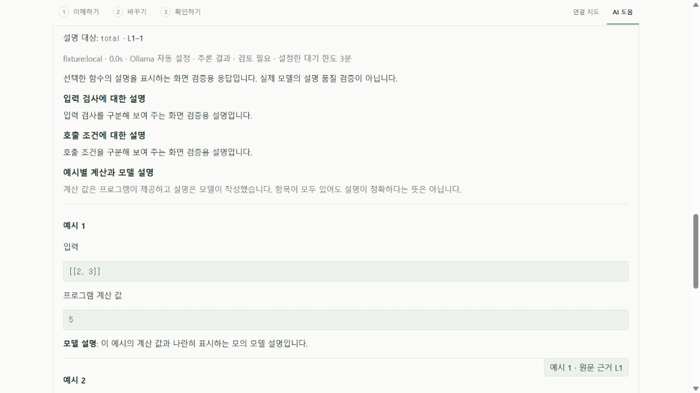
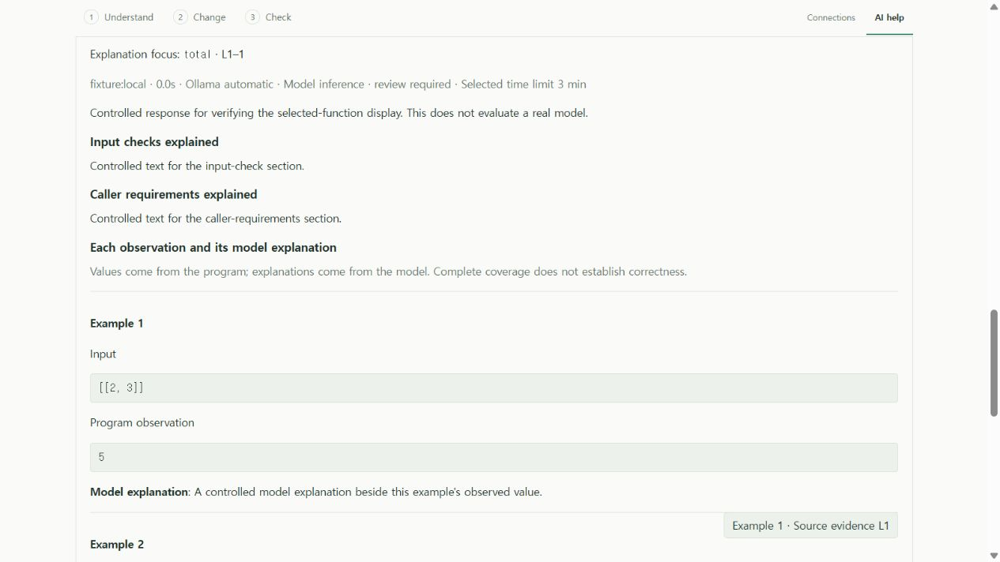

# 예시별 설명과 입력 조건 · Structured explanations

**0.7 개발판.** 실제 사용자 코드 평가에서 작은 로컬 모델은 올바른 원문을 인용하면서도 경계 사례를 건너뛰거나 입력 검사와 호출 조건을 섞었다. [이전 실패 기록](evidence/local-ai/observed-explanation-models.json)은 유지한다. 설명의 구조를 확인하는 기능은 내용의 참·거짓을 자동으로 판정하지 않는다.

## 사용 흐름

로컬 AI에서 설명을 요청하면 요약과 원문 근거 아래에 **입력 검사에 대한 설명**, **호출 조건에 대한 설명**을 따로 표시한다. 설명 전용 응답에는 수정안이나 앞으로 할 검사 목록이 없다. 수정·최적화 작업의 응답은 기존 형식을 유지한다.

선택한 JS/TS 함수에 [계산 예시](EXPLANATION_OBSERVATIONS.md)를 첨부하면 각 입력의 프로그램 계산값과 모델 설명을 함께 표시한다. 예시마다 원문 근거 버튼으로 이동할 수 있다. 확인 불가라는 계산 상태만으로 실제 프로그램이 예외를 낸다고 단정하지 않는다. 모델은 원문에서 확인되는 동작과 자신이 모르는 부분을 구분해야 한다.





화면은 실제 UI/worker와 공개 예제, 모의 편집기·모델 응답으로 검증했다. 실제 모델 품질이나 native VS Code 수동 조작의 근거로 세지 않는다. 언어 변경 시 이전 언어 응답을 숨기고, 입력 변경 시 계산과 설명을 해제하는 흐름도 확인했다.

## 프로그램이 확인하는 것

- 지원하는 설명 언어 모두에 설명 전용 JSON 계약을 사용한다. `summary`, `citations`, `inputChecks`, `callerRequirements`, `examples`가 필수다. 비어 있거나 너무 긴 설명, 다른 필드, 기존 수정 응답 형식을 거절한다.
- 첨부 예시가 있으면 각 번호가 정확히 한 번 있어야 한다. 누락·중복·범위 밖 번호와 존재하지 않는 인용 번호를 거절한다. 예시가 없으면 예시 설명은 빈 배열이어야 한다.
- 모델은 예시의 입력·계산값을 응답 필드로 대체할 수 없다. 화면의 값은 호스트가 보관한 계산 결과이며 모델 설명은 별도 필드다.
- 인용은 기존과 같이 원문에 유일하게 존재해야 하고, 선택 함수 설명은 그 안의 인용을 포함해야 한다. 예시의 인용 번호는 확인한 원문 이동 기능에 연결된다. 이 검사는 인용과 주장 사이의 의미 관계를 입증하지 않는다.
- 기존 한국어 포함 검사에 새 설명 필드도 포함한다. 원문 코드·계산값은 번역하지 않는다. 실제 문맥 계산에는 현재 작업의 응답 스키마 크기도 반영한다.

`src/core/localAssistant.ts`가 스키마·프롬프트·응답 검사를 맡고 `extension/src/ollama.ts`가 실제 요청에 해당 스키마를 전달한다. `extension/ui/LocalAssistant.tsx`는 프로그램 값과 모델 설명을 나눠 표시한다. 원문을 자르거나 입력·출력 한도를 늘리지 않는다. 수정·최적화 제안의 검사와 native diff·명시적 적용은 그대로다.

## 검증과 한계

핵심 부분 검사 **42개/5파일**와 확장 빌드를 통과했다. 새 6개 검사는 필수 필드·예시 누락/중복·인용 범위·새 필드의 한국어 검사·실제 스키마 문맥 예산을 확인한다. 의도적으로 잘못된 의미의 문장을 포함한 형식상 정상 응답도 파서가 보존함을 검사해, 구조 검사를 정확도 인증으로 취급하지 않는다.

```sh
pnpm exec vitest run tests/explanation-coverage.test.ts tests/local-assistant.test.ts tests/ollama.test.ts tests/assistant-observations.test.ts tests/local-ai-progress.test.ts
pnpm extension:build
node scripts/test-extension.mjs --explanation-observations
pnpm extension:package
node scripts/test-extension.mjs --installed --explanation-observations
node scripts/preview-function-format.mjs --focus
```

기능 커밋 `49b1a2b`의 [Windows·Ubuntu CI](evidence/local-ai/explanation-coverage-ci.json)는 각 **핵심 324개·실제 개발 확장 65개·production 설치본 65개**를 통과했다. 설치 파일 11개 해시와 패키지 검사 7개를 대조했다. 실제 VS Code 검사는 제어된 HTTP 모델 응답으로 별도 항목·예시별 원문 이동·중복 예시 거절·원문 보존을 확인한다. [로컬 검사·화면 범위와 해시](evidence/local-ai/explanation-coverage-verification.json). 실제 로컬 모델의 의미 평가는 아래와 별도다. 한 함수·선정 입력의 결과로 프로젝트 전체·모든 언어·최적화 완료를 주장하지 않는다.

**실제 모델 첫 결과:** 같은 비공개 원문·질문·일곱 예시로 3B 모델에 10분 한도를 선택했다. 약 278초에 원시 응답이 완성됐고 일곱 예시 번호와 정확한 인용 네 개가 있었지만, 예시 두 개가 존재하지 않는 인용 번호를 사용해 제품이 거절했다. 별도 의미 검토에서도 실제 검사와 호출 전제를 섞고 경계 결과를 잘못 설명했다. [익명 기록](evidence/local-ai/explanation-coverage-models.json). 형식 보강이 의미 정확도를 해결했다고 하지 않는다.

**7B 비교 결과:** 같은 원문·질문·예시와 10분 한도로 약 509초에 완성됐다. 정확한 인용 네 개와 일곱 예시의 번호·연결은 통과했다. 주된 동작·범위 처리·빈 입력 오류를 대체로 설명했지만 실제 검사와 호출 조건에 같은 잘못된 전제를 반복했고, 세 경계 사례가 제공한 계산 결과와 모순됐다. 제품의 구조 검사는 통과, 이 설명 과제의 의미 검토는 실패로 따로 기록한다. 전체 예시가 표시되어도 그 설명이 정확한 것은 아니다.

두 요청은 기존 모델 파일을 사용하는 cloud-disabled 로컬 CPU 추론이며 유료 API를 호출하지 않았다. 원본은 변경하지 않았고 평가 후 전용 서버만 종료했다. 하나의 고정 과제에 대한 에이전트 검토이며 제삼자 정확도 평가나 속도 개선 자료가 아니다. 원문·식별자·구체 입력/결과·원시 모델 답변은 비공개 로컬 자료로 보존한다.
