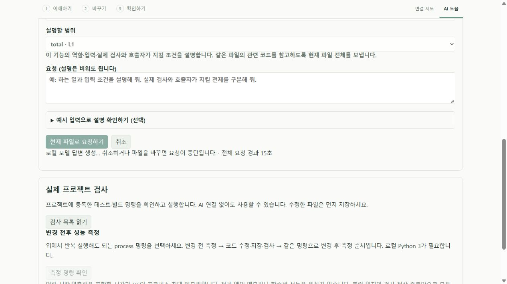
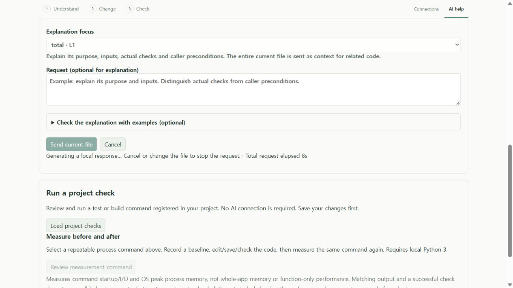

# 로컬 AI 검증 자료 · 2026-10-16

2026-10-20 설명 구조 후속: [입력 검사·호출 조건·예시별 설명과 누락 검사](../../STRUCTURED_EXPLANATIONS.md). 모든 항목의 존재와 실제 인용 연결을 확인하며 모델 의미의 참·거짓은 별도 검토다. 기존 실제 실패 기록은 유지한다.

2026-10-20 요청 단계 후속: [같은 실제 과제의 네 요청·검토 기준](observed-explanation-models.json). 3B 기본 3분, 4B 선택 5분, 7B 선택 10분 요청은 약 158·242·315초에 완성됐으나 의미 오류나 요구 사항 누락이 남았다. 4B 기본 3분 요청은 생성 시간 초과였다. [단계 표시와 직접 선택하는 대기 한도](../../LOCAL_AI.md)는 이를 구분·진단하는 기능이며 설명 정확도 개선 근거는 아니다. 아래 화면은 실제 UI와 공개 fixture의 모의 진행 상태다.

기능 커밋 `fd9d0b2`의 [Windows·Ubuntu CI](local-ai-phases-ci.json)는 각 핵심 318개·개발/production 설치 각 64개·설치 파일 11개 해시·패키지 검사 7개를 통과했다. [로컬 단계별 로그 해시·부분 native·브라우저 범위](local-ai-phases-verification.json)를 따로 기록한다. 이 검사들의 모델 답변은 제어된 fixture이며 실제 모델 품질과 구분한다.

2026-10-20 설명 근거 후속: [사용자 예시를 AI 없이 계산하고 설명에 첨부](../../EXPLANATION_OBSERVATIONS.md), [부분 개발/설치 검사·실제 코드 대조·모델 실패 기록](explanation-observations.json). 실제 코드 반환 6개 일치와 확인 불가 1개를 모델 품질이나 기존 프로젝트 테스트 성공으로 합산하지 않는다. 한국어/영어 UI는 공개 fixture이며 비공개 소스를 포함하지 않는다.

기능 소스 `7a6e368`의 [Windows·Ubuntu CI](explanation-observations-ci.json)는 각 핵심 312개·개발/production 설치 각 64개·설치 파일 11개 해시·패키지 검사에 성공했다. 부분 실행·실제 모델 실패·직접 브라우저 조작 근거는 따로 유지한다.

2026-10-20 계산 출처 후속: [파일별 원본 이동](../../TRACE_NAVIGATION.md), [핵심/실제 개발/새 설치 검증과 실패 이력](trace-navigation.json). 이전 반복 계산 버전의 다른 파일 줄 이동 결함을 수정했다. 공개 fixture로 검사했으며 비공개 프로젝트 전체 성공·모델 품질·성능 개선으로 세지 않는다.

긴 경로 표시를 포함한 `13752f4`의 [Windows·Ubuntu 최종 CI](trace-navigation-ci.json)는 각 핵심 304개·개발/production 설치 각 61개·설치 파일 11개 해시·패키지 검사에 성공했다. 로컬 부분 실행/전체 실패와 직접 UI 미확인을 구분한다.

2026-10-20 반복 계산 후속: [한도 있는 반복문·배열 콜백](../../BOUNDED_PREVIEW.md)으로 실제 사용자 코드의 원래 대상 함수가 계산된다. 원래 assertion 3사례와 선정 11사례가 Node와 일치했다. 이전 모델 실패와 전체 언어/연구 타당성은 별도다. [검사 실패를 포함한 실행 기록](iteration-preview.json).

반복 계산 기능 커밋 `5242fcc`의 [Windows·Ubuntu CI](iteration-preview-ci.json): 각 핵심 301개·개발/production 설치 각 58개·설치 파일 11개 해시·추출 도구 성공. 로컬 시간 초과·UI 연결 실패와 남은 다른 파일 trace 이동 결함은 별도로 유지한다.

2026-10-20 계산 표시 후속: [특수 값 보존·프로젝트 경로 수정·실제 코드 대조](preview-values.md). 변경하지 않은 비공개 코드의 지원 가능한 함수에서 선정한 입력 4개가 Node와 일치했다. 원래 요청 대상 함수는 계속 확인 불가다. 모델 평가·프로젝트 원래 테스트와 합산하지 않는다. [수정 전 공개 예제](preview-values-before.json), [실행별 실패·성공 기록](preview-values-verification.json), [한국어](preview-values-ko.jpg)/[영어](preview-values-en.jpg) 화면을 구분한다.

값 전달 한도 보완까지 포함한 `66a6781`의 [Windows·Ubuntu CI](preview-values-ci.json): 각 핵심 266개·개발/설치 각 57개·production 모드·파일 11개 해시·추출 도구 성공. [격리 변경안 PR #1](https://github.com/him55710-sudo/pureobom/pull/1)에 공개했으며 안정판 배포나 실제 사용자 과제 완료로 처리하지 않는다.

2026-10-20 CPU 후속: [같은 실제 과제의 원문 구분·CPU 요청](focused-context-cpu.md). 세 번 완성 응답을 받았으나 인용 또는 의미 검토에서 모두 실패했다. 인용 통과와 설명 정확성을 분리한다. 한국어/영어 CPU 선택과 이전 결과 해제를 확인했으며, 기존 timeout과 포매터 성공은 그대로 보존한다.

CPU 옵션 제품 커밋 `954d6cf`의 [Windows·Ubuntu CI](focused-context-cpu-ci.json): 각 핵심 **260개**, 개발/설치 각 **55개**, production 모드·파일 11개 해시·추출 도구 검사를 통과했다. 실제 사용자 코드의 모델 응답은 별도 평가이며 이 CI의 통과 수에 넣지 않는다.

2026-10-20 함수 설명 후속: [함수 선택·원문 인용·실제 프로젝트 시도](focused-explanation.md). 실제 사용자 코드의 두 생성 요청은 각각 180초 시간 초과로, 설명 품질은 미확인이다. [개발 호스트 55개](focused-explanation-development-integration.json), [설치본 55개](focused-explanation-installed-integration.json), [핵심 검사 실패를 포함한 실행 기록](focused-explanation-verification.json), [한국어](focused-explanation-ko.jpg)/[영어](focused-explanation-en.jpg) 화면은 서로 다른 증거다. [사용 방법과 전달 범위](../../FOCUSED_EXPLANATIONS.md). 비공개 원문·응답은 공개하지 않는다.

함수 선택 제품 소스 `9758dac`의 [Windows·Ubuntu CI](focused-explanation-ci.json)는 각 핵심 **259개**, 개발/production 설치 각 **55개**, 설치 파일 11개 해시와 추출 도구 검사를 통과했다. 같은 흐름을 실행 환경 수만큼 새 기능으로 합산하지 않는다. 로컬 timeout 기록과 실제 모델 실패는 유지한다.

2026-10-20 Rust 후속: [humantime 실제 편집기·기존 테스트](rust-source-project.md)에서 42 pass → 상수 변경으로 8 fail → native undo 후 42 pass와 원본 복구를 확인했다. 환경 준비 실패도 별도로 보존한다. [최종 소스 Windows·Ubuntu CI](rust-source-ci.json)는 각 핵심 258개·개발/설치 각 54개·파일 11개 해시·추출 WASM 실행을 통과했다. [구현 범위](../../RUST_SOURCE.md), [이전 개발](rust-source-development-integration.json), [이전 설치](rust-source-installed-integration.json), [한국어 화면](rust-source-reading-ko.jpg), [영어 변경안](rust-source-review-en.jpg). 실제 모델 의미 정확도·최적화 성과는 미검증이다.

2026-10-20 C# 후속: [GuardClauses 실제 편집기·기존 테스트 연결](csharp-source-project.md)에서 959 pass → 검증용 경계값 변경으로 7 fail → native undo 후 959 pass와 원본 복구를 확인했다. 첫 실행의 BOM 위치 오류와 수정도 공개한다. 이는 회귀 검출 연동 검사이며 AI 품질이나 실제 사용자 과제의 성공은 별도다.

2026-10-20 후속: [모델 없는 JS/TS 함수 서식 정리](function-format.md). 사용자 지정 실제 프로젝트의 기존 테스트 **8→8→8 통과**, native 적용·undo·원본 복구를 확인했다. 전체 핵심 242개·개발 호스트 51개, 한국어/영어 실제 UI 검증을 별도 기록한다. 이전 AI 요청 실패나 설명 품질·성능 최적화 성공으로 재분류하지 않는다.

[SQLite 원문 읽기·값 수정](../../SQL_SOURCE.md), [개발 43개](sql-source-development-integration.json), [설치 43개](sql-source-installed-integration.json), [외부 sqlc 예제](sql-source-project.md)를 추가했다. 명시적 방언·정확한 수정·diff·undo와 실제 재생성/Go 테스트 1 pass → 고정 오류 1 fail → 복구 1 pass를 확인한다. 개발 기록은 마지막 SQL 위치 보정 전이며 설치/CI는 별도 버전 근거를 따른다. 모델 의미 정확도·쿼리 최적화·전체 sqlc 테스트 성공으로 합산하지 않는다.

SQLite 소스 `3b1aa4d`의 [Windows·Ubuntu CI 원자료](sql-source-ci.json): 각 핵심 **217개**, 개발/설치 각 **43개**, production 모드·런타임 8개 해시·추출 도구 5종 성공. [SQL 실제 화면](sql-source-native.md)은 한국어/영어 읽기, 한국어 값 수정·diff·적용·Ctrl+Z와 원문 복구, 남은 화면·진단 제약을 별도로 기록한다.

화면에서 발견한 문구와 diff 제목 언어 수정 후 [별도 설치본 43개](sql-source-localization-installed.json)와 [한국어/영어 VS Code 탭 제목](sql-source-localization-titles.json)을 확인했다. 앞선 수동 화면·기능 CI와 후속 수정본의 해시를 구분한다.

Java 기능·CI 설정 소스 `3ecae6e`의 [Windows·Ubuntu CI 원자료](java-source-ci.json): 각 핵심 **208개**, 개발/설치 각 **41개**, production 모드·런타임 8개 해시·추출 도구 5종 성공. [Java 실제 화면](java-source-native.md)은 한국어/영어·원문 이동·값 수정·diff·적용·undo와 남은 사용성 제약을 별도로 기록한다.

[Java 원문 파서](../../JAVA_SOURCE.md)의 [개발 41개](java-source-development-integration.json)·[설치 41개](java-source-installed-integration.json), production 모드·런타임 8개 해시를 추가했다. [외부 minimal-json](java-source-project.md)은 원본 452 pass → 고정 오류 13 fail → undo 후 452 pass와 정확한 파일 복구를 확인했다. 최신 JDK에서 원래 테스트 도구를 실행하기 위한 호환 설정과 준비 실패도 보존했다. 모델 정확성·최적화 성공 점수로 합산하지 않는다.

외부 검증 도구·기록 소스 `493cd04`의 [Windows·Ubuntu CI 원자료](web-project-ci.json): 각 핵심 **200개**, 개발/설치 각 **38개**, production 모드·런타임 7개 해시·추출 도구 실행 성공. 아래 외부 Chrome 검사는 이 CI의 집계에 포함되지 않는다.

[외부 modern-normalize HTML/CSS 검증](web-source-project.md)을 추가했다. 실제 VS Code에서 CSS 값 하나 변경 후 Chrome 실패 7→9→undo 후 7을 확인했다. 원본 실패 7개와 assertion 없는 TODO 8개, 브라우저 연결 실패 두 번, 실행기 종료 코드·프로필 격리 보강도 원자료에 보존한다. 전체 upstream 통과나 최적화 성공 사례는 아니다.

HTML/CSS 기능 소스 `20de714`의 [Windows·Ubuntu CI](web-source-ci.json)는 각 핵심 **200개**, 개발/설치 각 **38개**, production 모드·런타임 7개 해시·패키지 도구 실행에 성공했다. [실제 화면](web-source-native.md), 로컬 설치본과 외부 웹 프로젝트 검증은 별도 기록이다.

[HTML/CSS 파서 읽기·값 수정](../../HTML_CSS_SOURCE.md)의 [개발 38개](web-source-development-integration.json), [설치 38개](web-source-installed-integration.json), [실제 화면](web-source-native.md)을 추가했다. API/모델 없이 원문 값과 diff·적용·undo를 확인한 자료이며, 실제 모델 응답 수나 외부 페이지 동작 검증 수에 합치지 않는다. 마지막 주석/식별자 수정 전 화면 설치본과 이후 검증은 구분한다.

마지막 CSS 주석/식별자 수정 후 [새 설치본 38개](web-source-final-installed-integration.json)도 통과했다. VSIX `88761109…`, production 모드와 런타임 7개 해시를 대조했다. 이전 설치/화면의 VSIX `109782f6…`와 같은 파일로 취급하지 않는다.

Go 기능 소스 `5b9e5f0`의 [Windows·Ubuntu CI 원자료](go-source-ci.json): 각 핵심 **185개**, 개발/설치 각 **36개**, production 모드·런타임 7개 해시·패키지 도구 4종 성공. [네이티브 Go 화면](go-source-native.md)과 [외부 프로젝트](go-source-project.md)는 별도 증거다.

[Go AST 읽기·수정](../../GO_SOURCE.md)과 [Google UUID 외부 프로젝트 원자료](go-source-project.md)를 추가했다. 설치된 표준 파서와 실제 편집기/task로 201 pass·1 skip → 고정 오류의 TestUUID 실패 → undo 후 복구를 확인한다. 모델 없이 수행한 검사이며 모델 정확도나 최적화 성공 점수에 합치지 않는다.

현재 자료는 자동 연결 검사, 실제 모델 응답, 외부 프로젝트 연동과 성능 측정을 구별한다. 공개 소스와 합성 예제만 사용했다. 사용자 비공개 코드·키·개인정보는 포함하지 않았다.

[Python AST의 모델 없는 읽기·수정](../../PYTHON_SOURCE.md)도 추가했다. [외부 itsdangerous 원자료와 재현](python-source-project.md)은 실제 VS Code에서 원문 값 하나를 바꾸고 upstream 테스트 **297개 통과→38개 실패→undo 후 297개 통과**를 확인한다. 모델 의미 정확성이나 성능 개선으로 집계하지 않는다.

Python 기능 `583c805`의 [Windows·Ubuntu CI 원자료](python-source-ci.json): 각 핵심 **178개**, 개발 호스트·설치본 각각 **33개**, production 모드·런타임 6개 해시와 추출한 도구 3종 실행 성공. [네이티브 화면](python-source-native.md)은 한국어/영어 설명·값 수정·diff·적용·원문 이동·undo를 확인한 별도 기록이다.

JSONC의 소비 동작 추측에 대응해 [모델 없는 데이터 읽기·수정](../../JSON_DATA.md)을 추가했다. 파서가 확인한 키·값과 모델 해석을 구별하며, 실제 VS Code의 원문 보존·diff·큰 정수 수정·undo를 검사한다. 모델의 의미 정확성 개선 점수로 세지 않는다.

`2b0235e`의 [Windows·Ubuntu CI](json-facts-ci.json): 각 핵심 169개·개발/설치 각 31개, production 모드·런타임 해시와 추출한 Worker 검사 성공. [로컬 설치본](json-facts-installed-integration.json)과 [브라우저 실제 조작·제약](../../JSON_DATA.md)은 별도 기록이다. 네이티브 JSON 화면 조작의 추가 시도는 대상 창을 찾지 못해 성공으로 세지 않았다.

추가 자료: [분기·경계·데이터 의미의 모델 비교](semantic-review.md), [외부 JavaScript clsx 검사 연결](clsx-review.md). 모델 비교에는 실패와 누락을 보존하고, clsx에는 Node 24 준비 실패와 호환 런타임에서의 실제 32개 검사·고정 오류 발견·undo 복구를 함께 공개한다.

기능 소스 `a184b68`의 [Windows·Ubuntu CI](semantic-ci.json)는 각각 핵심 162개·개발 실행 30개·설치 실행 30개·추출 Worker 검사를 확인한다. [로컬 설치본 원자료](semantic-installed-integration.json)와 실제 설명 60회(한국어 50, 영어 10)는 서로 다른 검증이다. 둘을 합쳐 모델 정확도 점수로 쓰지 않는다.

| 자료 | 실제 확인 내용 | 해석 한계 |
| --- | --- | --- |
| [Python 설명](python-explain.json) | Ollama 0.40.5, qwen2.5-coder:3b, 한글 설명과 원문 인용 | 합성 배송 예제 1회, 의미 정확성 전체 보장 아님 |
| [Python 수정](python-edit.json) | 무료 배송 기준 변경 제안, 원문 일치 확인 | CLI 제안 생성; 편집기 적용 검사와 별도 |
| [한국어 요청 보강 후 설명](python-explain-language-guard.json) | 기본 요청을 한국어로 바꾸고 한국어 문장 최소 검사 후 실제 모델 재실행, 10.9초 | 한국어 응답은 받았지만 파일 주석만 요약해 배송비 계산 설명이 부족함. 설명 품질 성공 사례로 세지 않음 |
| [VSIX 설치본 화면](installed-ui.md) | 별도 설치 프로필에서 실제 Ollama 연결 → 한국어 수정 요청 → diff → 명시적 적용 → 디스크 무저장 확인 → Ctrl+Z → 영문 UI 전환 | 합성 Python 예제 1건. 모델 설명의 부정확한 시제도 관찰. 영어 모델 응답 검증과 별도 |
| [언어별 28회 응답과 의미 검토](language-review.md) | 14개 언어 식별자의 합성 파일에 실제 설명·수정 요청. SQL 수정 1건은 원문 근거 불일치로 거절 | CSS·JSONC 등의 틀린 설명, JS의 잘못된 확인 항목, Python/Go 설명 누락 발견. 형식 통과를 의미 정확성으로 세지 않음 |
| [VS Code 통합](vscode-controlled-integration.json) | 19개 실제 VS Code 검사. 새 AI 검사는 제어된 HTTP 응답으로 다중 편집·undo·오래된 제안·취소·문법 오류 적용 거절 확인 | 새 AI 3개 사례는 실제 모델 추론이 아님 |
| [JSONC 보강 후 VS Code 통합](vscode-jsonc-integration.json) | 새 테스트 프로필에서 20개 검사. JSONC 미저장 문서·문법 오류·undo 검사 추가 | 제어된 AI HTTP 검사와 실제 모델 응답 기록은 별도 |
| [프로젝트 검사 기능의 외부 연동](itsdangerous-project-checks.json) | VS Code task로 pytest 실행: 297개 통과 → 의도적인 오류로 실패(exit 1) → undo·저장 후 297개 통과. 미저장 실행 차단 확인 | 모델 제안이 아닌 검토한 고정 오류를 넣은 검사. UI는 종료 코드만 기록하고 이 개발 검증 스크립트가 JUnit XML에서 개수를 읽음 |
| [프로젝트 검사 보강 후 VS Code 통합](vscode-project-checks-integration.json) | 실제 VS Code 통합 25개. 실제 process/shell 성공·실패, 미저장·중복 실행 차단, 다른 파일 변경, 빠른 취소·재실행, 명령 변경 시 재검토 | 합성 명령으로 검사 연결을 확인. 외부 Python 프로젝트 기록과 별도 |
| [최종 Windows·Ubuntu CI](project-checks-ci.json) | `a3e6f84`에서 각 OS 핵심 152개·VS Code 통합 25개와 패키지 Worker 검사 성공. 실제 설정값 변경과 셸 인용 수정 포함 | 실제 모델·외부 프로젝트 테스트는 CI 밖의 별도 기록. 모든 언어/환경 보장 아님 |
| [보강 전 외부 사례](itsdangerous-before-citation-guard.json) | 실제 Ollama + VS Code + itsdangerous 전후 297개 테스트 성공 | 품질 검토에서 관련 없는 import 인용과 불필요한 조건 발견. 성공한 최적화로 세지 않음 |
| [보강 후 외부 사례](itsdangerous-integration.json) | 변경-인용 연결 검증 후 실제 Ollama + VS Code + Python 문법 검사 + 전후 297개 테스트 + 원본 복구 | 여전히 불필요한 조건이 있어 성능 측정을 추가함 |
| [성능 원자료](optimization-benchmark.json) | 실제 제안 전후, 입력·예외·객체 동일성 10개 확인, 사례별 15회 × 10만 호출, 교대 순서와 워밍업 | 단일 함수·PC 측정. 문자열 입력에서 약 24~38% 느림. 제안 미채택 |

외부 프로젝트는 [Pallets itsdangerous](https://github.com/pallets/itsdangerous), 태그 2.2.0의 커밋 `096c8d42545d3b68ea21a4f890fb2b2d8979c0bd`, `src/itsdangerous/encoding.py`다. 보고서의 원문 인용에는 해당 프로젝트의 [BSD 라이선스](ITSDANGEROUS_LICENSE.txt)가 적용된다. upstream 저장소에 변경을 제출하지 않았고 검증 복사본은 원본으로 복구했다.

환경: Windows, Python 3.12.10, VS Code 1.96.4, Ollama 0.40.5, RAM 약 32GB, NVIDIA MX450 2GB. 모델 digest는 각 보고서에 있다. 소요 시간에는 모델 로드 상태에 따른 차이가 있을 수 있다. pytest 전체 소요 시간은 함수 최적화 수치로 사용하지 않는다.

## 재현

새 [설치본 상태 검증](installed-ui-states.md)은 한국어/영어 안내, 생성 중 언어 변경과 취소, 완료 응답 숨김, 큰 파일과 미지원 파일을 네이티브 화면에서 확인한다. 실제 3B 응답의 누락도 기록했다. 별도의 [설치 VSIX 통합 검사](installed-vsix-integration.json)는 제품 경로·production 모드·파일 해시를 검증하고 실제 VS Code 흐름을 실행한다. 실제 모델/화면/제어된 HTTP 검사를 혼합해 정확도 점수로 세지 않는다.

[설치 검증의 Windows·Ubuntu CI](installed-ci.json): `b1743a6`에서 각 핵심 161개·개발 실행 30개·설치 실행 30개와 추출한 Worker 검사 성공. 개발/설치의 30개는 같은 흐름을 다른 배포 방식에서 실행한 것이다. 네이티브 기록에는 이후 실제 미실행 포트의 연결 실패와 빈 모델 폴더를 사용하는 별도 Ollama의 안내·요청 차단도 추가했다.

측정 기능 커밋 `d819c49`의 [Windows·Ubuntu CI 증거](benchmark-ci.json)는 각 161개 핵심 검사·30개 실제 VS Code 통합 흐름·추출한 분석 및 Python 측정 Worker 실행 성공을 기록한다. 통합 검사의 로컬 AI 응답은 제어된 fixture이며 실제 Ollama 응답 자료와 구별한다. 새 측정 화면을 설치본에서 클릭·키보드로 모두 검증했다는 뜻은 아니다.

사용자용 전후 측정 기능의 실제 자료도 추가했다. [최초 설정 실패](itsdangerous-command-benchmark-setup-failure.json), [실행기 메모리를 잘못 해석할 수 있었던 첫 측정](itsdangerous-command-benchmark-before-memory-fix.json), [실행기 메모리 제외 후 재측정](itsdangerous-command-benchmark.json). 전후·복구 후 pytest 각 297개를 확인했고 같은 제안의 실행 시간은 두 차례 모두 늘었다(약 14.1%, 21.1%). 최종 기록은 Windows 가상환경 실행기 때문에 메모리 비교가 없다. 이 숫자는 전체 명령·프로세스 시작을 포함하며 앞선 함수 단위 교대 측정과 다르다. [측정 방식](../../BENCHMARKS.md).

같은 고정 외부 저장소와 Python 환경에서 `node scripts/test-local-project.mjs --benchmark-only`로 재현한다. Ollama는 필요 없으며 이미 검토한 특정 변경 한 건만 재현한다. tasks.json은 없을 때만 VS Code 시작 전에 생성하고 검증 종료 후 제거한다. 다른 파일은 덮어쓰지 않는다.

1. 프로젝트의 Node/pnpm 의존성과 Ollama를 설치한다. `OLLAMA_NO_CLOUD=1`, `OLLAMA_HOST=127.0.0.1:11435`로 Ollama를 실행하고 `qwen2.5-coder:3b`를 내려받는다. 기본 포트를 쓴다면 아래 검증 스크립트의 `PUREOBOM_PROJECT_PORT` 환경 변수를 지정한다.
2. `git clone --depth 1 --branch 2.2.0 https://github.com/pallets/itsdangerous.git test-results/projects/itsdangerous` 후 위 커밋인지 확인한다. 스크립트도 커밋과 깨끗한 작업 트리를 확인한다.
3. `python -m venv test-results/python-venv`. Windows에서는 `test-results/python-venv/Scripts/python.exe`, macOS/Linux에서는 `test-results/python-venv/bin/python`으로 `-m pip install pytest==8.3.5 freezegun==1.5.1 flit_core==3.12.0`, 이어서 `-m pip install --no-build-isolation --no-deps -e test-results/projects/itsdangerous`를 실행한다.
4. `pnpm extension:build` 후 `node scripts/test-local-project.mjs`. 별도 VS Code 프로필에서만 작업하며 결과는 `test-results/local-project-report.json`에 저장된다. Linux의 그래픽 세션이 없으면 `xvfb-run -a node scripts/test-local-project.mjs`를 사용한다. 실제 모델 테스트는 일반 CI에서 자동 실행하지 않는다.
5. `python scripts/benchmark-local-proposal.py`는 검토한 특정 변경만 허용한다. 모델이 다른 변경을 반환하면 먼저 코드를 검토해야 하며, 스크립트는 알 수 없는 제안을 실행하지 않는다. 결과는 `test-results/local-optimization-benchmark.json`이다.

단일 파일 추론만 확인하려면 `node scripts/probe-local-assistant.mjs examples/shipping.py python qwen2.5-coder:3b 11435 explain`. 이 명령은 수정 내용을 적용하거나 실행하지 않는다. 모델 출력은 반복 실행마다 달라질 수 있으며, 현재 결과가 미래 실행의 성공을 보장하지 않는다.

프로젝트 검사 기능만 재현하려면 같은 고정 외부 저장소·Python 가상 환경을 준비하고 `pnpm extension:build`, `node scripts/test-local-project.mjs --checks-only`를 실행한다. Ollama는 필요 없다. 검증용 tasks.json은 없을 때만 임시 생성하고 끝나면 지운다. 실제 편집기로 고정 오류를 적용·저장해 실패를 확인하고 undo·저장 후 다시 검사한다. 종료 후 외부 복사본의 `git status --porcelain`이 빈 결과인지 확인했다.
