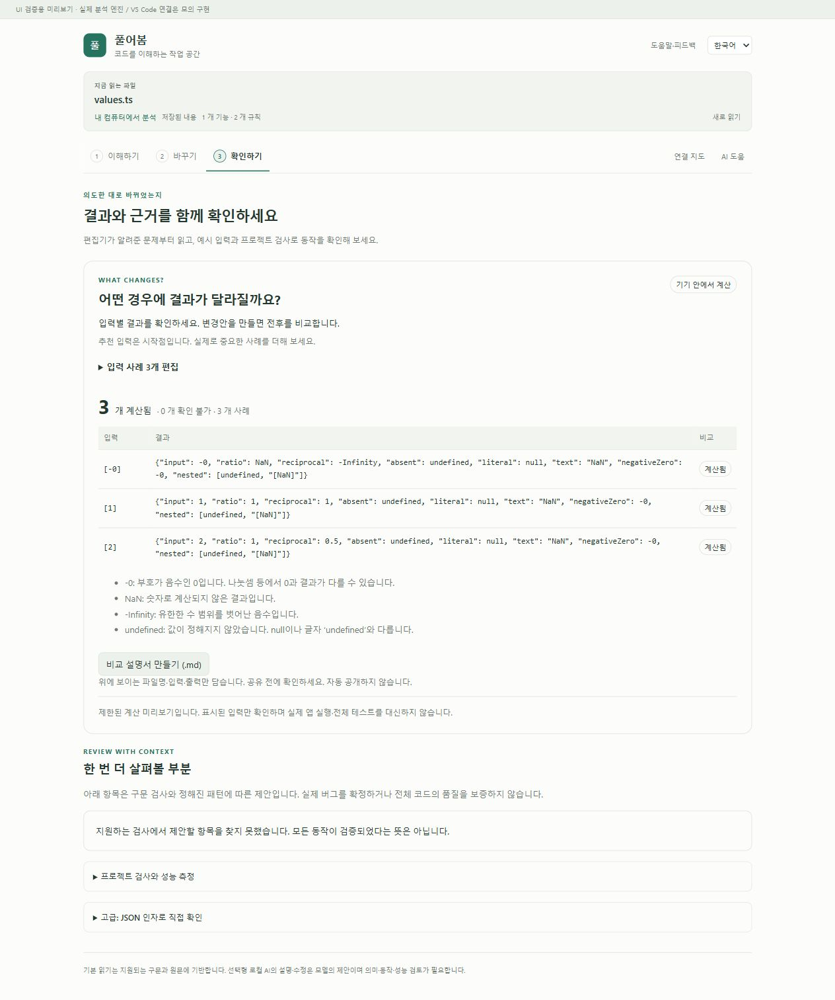
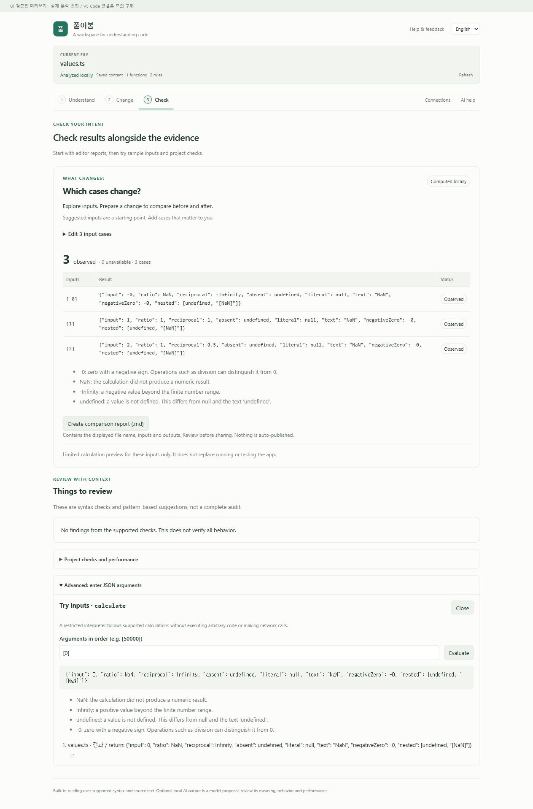

# 계산 값 보존과 실제 프로젝트 대조 · 2026-10-20

0.7 개발 소스의 제한된 JS/TS 계산 미리보기를 보완했다. 안정판·Pages는 0.6.0이며, 이 작업을 전체 프로젝트 동작·모델 설명 정확성·성능 최적화의 성공으로 세지 않는다.

## 발견한 문제

해석기가 반환한 `NaN`, `Infinity`, `-Infinity`는 VS Code 화면으로 전달할 때 `null`이 되고, `-0`은 `0`이 됐다. 객체의 `undefined` 속성은 사라지고 목록의 `undefined`는 `null`이 됐다. 반환 경로 설명도 `JSON.stringify`를 사용해 이미 다른 값을 표시했다. 입력 `-0` 역시 화면에서 호스트로 전달될 때 부호를 잃을 수 있었다. [수정 전 공개 예제 원자료](preview-values-before.json).

VS Code 메시지는 JSON으로 직렬화할 수 있어야 하며, JSON의 숫자·undefined 변환은 명세에 정의돼 있다. [VS Code webview 문서](https://code.visualstudio.com/api/extension-guides/webview), [ECMAScript JSON 직렬화](https://tc39.es/ecma262/2022/multipage/structured-data.html).

## 구현 범위

- `src/core/previewValues.ts`: 모든 값을 유형별로 감싼 `pureobom-preview-1` 형식으로 전달한다. 실제 문자열 `"NaN"`이나 태그처럼 생긴 일반 객체를 숫자로 오해하지 않는다. undefined 속성, 빈 배열 자리, 일반/null prototype 객체를 구분한다.
- `extension/ui/bridge.ts`, `extension/src/extension.ts`: simulate/compare의 요청과 응답에만 인코딩을 적용한다. 잘못된 응답은 실패로 반환한다. 다른 메시지와 브라우저 worker의 structured clone 경로는 그대로다.
- 결과 화면·반환 경로·비교표·Markdown은 같은 표시 함수를 사용한다. 한국어/영어 안내는 실제로 나타난 특수 값에만 표시한다. 문자열에는 따옴표를 남긴다.
- 한 메시지당 노드/키 방문 20,000회, 깊이 64, 문자열·키 합계 250,000 UTF-16 코드 단위를 넘기면 거절한다. 배열 길이 20,000 제한도 있다. 인코더/디코더의 방문량 계산을 같게 유지하며, 목록 컨테이너를 포함해 정확히 20,000노드인 경계도 왕복 검증한다. 순환 참조, 함수·Symbol·지원하지 않는 객체 prototype·getter는 지원하지 않는다. 공유 객체의 참조 동일성을 보존하는 일반 직렬화 도구가 아니다.
- 성공 결과도 전달 가능한지 먼저 확인한다. 실행기 지원 구문을 늘리거나 `eval`, 프로젝트 실행, 네트워크·모델 요청을 추가하지 않았다.

## 실제 사용자 프로젝트

변경하지 않은 비공개 사용자 파일의 지원 가능한 계산 함수 하나에서 **에이전트가 선정한 입력 4개**를 비교했다. 직접 Node로 불러온 원래 함수와 실제 제품 worker의 결과를 JSON 전달 형식까지 거쳐 대조했고 **4개가 일치**했다. 소스 해시는 유지됐다. 이 4개는 프로젝트 작성자의 원래 테스트가 아니다.

앞서 설명·수정을 요청한 별도의 대상 함수는 미지원 구문 때문에 계산 미리보기에서 여전히 **확인 불가**다. 이를 실패 없는 프로젝트나 요청 완료로 해석하지 않는다. 원래 테스트 8→8→8은 [별도 서식 정리 검증](function-format.md)의 결과이며 이번 입력 4개와 합산하지 않는다. 이전 모델 설명 실패도 유지한다. 비공개 파일명·함수명·입력·출력·원문은 공개하지 않는다.

## 검증과 실패 기록

- 핵심 전체: **266개/28파일 통과**. 새 값 전달 검사 6개는 중첩 값, 문자열 충돌, 빈 배열 자리, prototype 키, getter 호출 방지, 잘못된 형식·한도, 실제 해석기 및 비교/보고서를 확인한다.
- 첫 개발 호스트 실행 2회는 기존 비교 검사에서 실패했다. `.codex` 같은 숨김 상위 폴더까지 프로젝트 제외 규칙이 검사하여 연결된 소스를 누락한 실제 제품 오류였다. 원본 실패를 버리지 않고 프로젝트 내부 상대 경로만 검사하도록 수정했다. 테스트 프로젝트 루트도 `.run-*`로 만들어 어느 CI 경로에서든 재현하며, 내부 숨김 파일·폴더는 계속 제외하는지 확인한다.
- 그다음 실행은 기존 Python fixture의 중간 편집이 undo 뒤 남아 있어 실패했다. fixture가 편집기 포커스를 명시하고 undo 직후 원문 복구를 검증하도록 보강한 뒤 개발 호스트 **57개**를 통과했다. 값 전달 수정이 이 포커스 실패를 유발했다고 단정하지 않는다.
- 실제 VS Code 검사는 제품 controller/worker 결과를 별도 작은 webview에서 왕복시킨다. 인코딩하지 않은 대조군의 `NaN → null`과 인코딩한 결과의 보존을 함께 검사한다. 내장 React 화면을 자동 조작하는 검사는 아니다.
- 개발 호스트와 최종 production 설치본은 각각 **57개**를 통과했다. 설치한 패키지의 파일 11개 해시를 대조했고, 웹/확장 빌드와 저장소 밖으로 추출한 분석·Python 측정·Python/Go/Java/C#/Rust 도구 검사가 통과했다. 설치본 VSIX SHA-256은 `adf7a9d2edbb3a76fd72c6e46f947adb7322c1106fbc2020f6d56a0be71af7c1`이다. 최초 개발 통과 뒤 안내문 수집을 결과별로 제한한 UI 보완은 최종 설치본에 포함된다.
- 브라우저 UI 검사는 실제 빌드된 확장 화면·제품 worker와 모의 편집기/전달 경로를 사용했다. 한국어 비교표의 `[-0]`, 특수 값 안내와 Markdown 내보내기, 영어 고급 계산의 결과·반환 경로를 확인했다. 좁은 입력 셀에서 `[-0]`가 두 줄로 나뉘어 최소 너비를 보완한 뒤 다시 확인했다. 처음 고급 섹션 role 선택자가 실패해 화면을 다시 관찰하고 보이는 텍스트로 열었다.
- 수정 전 탐침은 처음 dependency 동적 require 때문에 번들 실행에 실패했다. dependencies를 external로 두고 다시 실행했다. 이 준비 실패는 제품 검사의 통과로 세지 않는다.

실행별 결과·패키지 해시는 [검증 기록](preview-values-verification.json)에 기록한다. 전체 제품 완성·모든 언어·원격 환경 지원으로 확대하지 않는다.

### 한도 경계 후속

위 로컬 전체/설치 기록은 첫 제품 커밋 `eb82dec`의 근거다. 이후 검토에서 디코더가 문자열 노드를 두 번 세는 차이를 발견했다. 인코더와 같은 방문량으로 맞추고 정확히 20,000노드인 문자열 목록의 왕복 및 한 노드 초과 거절을 기존 테스트에 추가했다. 보완 후 값 전달 검사 6개가 통과했다. 이 후속 소스의 전체 교차 운영체제 검증은 별도 CI 기록으로 구분한다.

최종 기능 커밋 `66a6781`의 [Windows·Ubuntu CI](https://github.com/him55710-sudo/pureobom/actions/runs/39313385881)는 양쪽 모두 성공했다. 각 핵심 **266개**, 개발/production 설치 각 **57개**, 설치 파일 **11개** 해시와 추출 도구 7개 항목의 성공을 실제 로그에서 확인했다. [CI 기록](preview-values-ci.json)은 운영체제별 패키지 해시·검사 시각을 포함한다. 같은 57개 흐름의 반복을 새 기능 수로 합산하지 않는다. 이 문서 후속 커밋과 검증한 기능 커밋도 구별한다.

## 재현

```sh
pnpm install --frozen-lockfile
pnpm test --maxWorkers=1
pnpm build
pnpm extension:build
pnpm extension:test
pnpm extension:package
pnpm extension:test:installed
pnpm release:package
pnpm release:check
node scripts/preview-ui.mjs --values
```

기존 통합 검사는 Python/Go/Java/.NET 실행기가 필요하다. 로컬 SDK 설정은 기존 언어 문서를 따른다. UI 서버는 사용 가능한 로컬 포트를 출력한다. 한국어 읽기 화면의 예시 확인을 열고 첫 입력을 `-0`으로 바꿔 계산한다. 영어 고급 입력에는 `[0]`을 넣어 계산한다. UI 예제는 공개 fixture이고 실제 사용자 프로젝트 근거와 구분한다.




